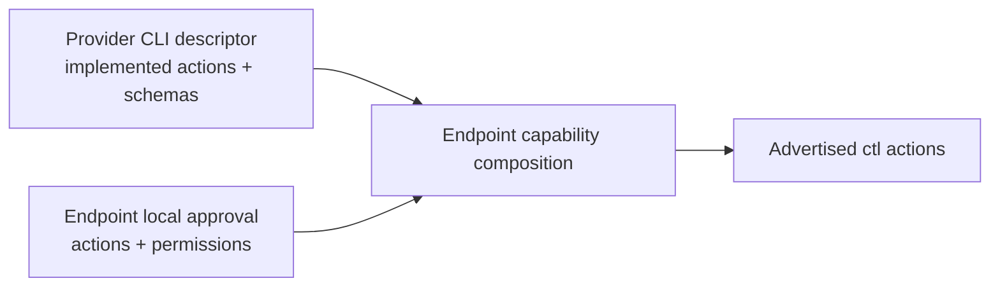
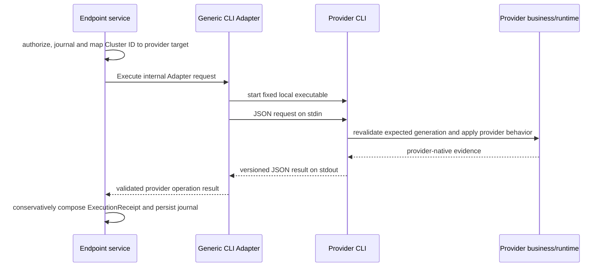

# Abstract Resources and Protocol

## Resource model

| Resource | Meaning | Key fields |
|---|---|---|
| Endpoint | One machine with one registered OS management daemon and multiple adapters | endpoint_id, display_name, labels, instance_id, connection_state, observed_at_ms |
| LaunchProfile | Endpoint-published standard execution preset | launch_profile_id, display_name, profile_revision, permitted standard inputs |
| Agent | Provider runtime identity or logical worker | provider_agent_id, provider_generation, state, state_reason |
| Session | A conversation/execution context | cluster_session_id, provider_session_id, provider_agent_id, provider_generation, state, observed_at_ms, provider_pid |
| Task | Optional unit of provider work | task_id, cluster_session_id nullable, parent_task_id nullable, state, progress nullable |
| Command | One admitted user intent | command_id, target, operation, payload_schema_version, deadline_at_ms, state |
| Observation | One typed state change or snapshot fact | endpoint_epoch, sequence, resource_id, resource_revision, observed_at_ms |
| OutputSource | Optional stdout/stderr/provider event source | source_id, target, kind, mode, cursor_support, retention_hint |

Agent, Session and Task are distinct: one agent may have several sessions; a session may have several tasks; a provider may have no task concept. Report an absent capability rather than inventing tasks. TopsailAI may need a synthetic logical worker identity per runtime binding/session; its exact mapping must be validated against real inventory before freezing the schema.

Use stable opaque cluster resource IDs scoped by Endpoint, privately mapped by Endpoint to adapter/provider IDs. Public IDs must not encode adapter routing semantics. Never use list row numbers, display names or bare PIDs as routing identities. Persist provider mapping; do not mint new IDs on each discovery. A PID can be a private locator hint but cannot be the sole generation proof. Provider ID reuse creates a new generation.

One provider session identifier may produce several independently selectable Session resources when the provider reports several execution/output rows for it. Each row receives its own opaque `session_id` in the cluster while retaining the shared `provider_session_id` as descriptive evidence. `provider_session_qualifier` is an optional descriptive label for distinguishing those sibling rows in an operator surface; it never participates in routing, authorization or capability selection. A provider session identifier that matches several rows is ambiguous input, so clients must require an opaque cluster ID or a previously rendered row number instead of selecting the first row.

Separate endpoint connection state (`online`, `suspect`, `offline`) from observed agent state (`running`, `idle`, `waiting_input`, `stopped`, `unknown`) and task state (`pending`, `running`, `succeeded`, `failed`, `cancelled`, `unknown`). Map only states supported by actual evidence; publish only a standard bounded reason code/message, keeping provider-specific diagnostics local. Store observation time and Server receive time separately. Creation/update timestamps are UTC epoch milliseconds; durations/deadlines are not inferred from timestamps alone.

## Implemented unverified session reporting and admission

A provider can list a session record while proving no live process behind it. For TopsailAI this
happens when no process holds the session output file, so `process_generation` is `null`
(`cli/cli_topsailai/core.py:1284-1287`). An empty generation therefore means **liveness unverified**,
not "the record does not exist".

The Endpoint reports such a session instead of dropping it. Dropping it made the session disappear
from the only surface that can address it, so an operator read a shorter list as "the task is gone"
while the record and its output were intact. The reported session carries `state=unknown` and
`state_reason=liveness_unverified`, with an empty generation.

Admission then follows one rule: an empty generation cannot prove which process an operation would
reach, so every operation that addresses a live process fails closed with `generation_required`.
`agent.resume` is the sole exception, because it addresses the provider session by handle and exists
precisely for the case where the process is gone.

The guard runs before generation revalidation, and that order is load-bearing. Revalidation compares
the requested generation with the observed one (`internal/endpoint/executor.go:301`), and two empty
strings compare equal, so without the guard an unverified session would pass the comparison and reach
the provider as if it were live. A regression test asserts that `message.send` and `agent.stop` are
rejected and `agent.resume` executes, and it fails when the guard is removed.

`InspectResult` separates `Found` from `Live` for the same reason. `Found` means the provider still
lists the record; `Live` means it also proved a process holds it. Resume authorizes on the absence of
a live target, so it reads `Live`. Reading `Found` would refuse to resume exactly the sessions resume
exists for.

The TUI keeps the row visible and labels it `unverified`. Entering it is refused with the real reason
and the resume hint, never with "session not found" and never with "generation changed", because
neither is true and both hide the only recovery step.

The fleet summary reports the reported state only. An unverified session is reported as `unknown`, so
it is counted in the unknown bucket like any other unknown state, and the summary line names no
subset. The line therefore reports one dimension, the reported state, and its numbers add up to the
row count. An earlier version appended `unverified(n)` after the state tally; that was removed on
2026-11-09 because a second label on the same line made the numbers ambiguous about which dimension
each one counted. The per-row distinction is carried by the table row, the `info` detail and the
refusal message instead, so dropping the label hides nothing. The flag is derived from `state_reason`
at render time rather than stored in the report, so one fact has one source of truth and no protocol
or schema change is needed.

The session-state colour mapping is deliberately small, because a colour is read before any label
is. Green means running, dim means a state that needs no attention, red means a state that needs
attention, and yellow is the remaining uncertain middle:

| Colour | States | Meaning |
|---|---|---|
| green | `running` | actively working |
| dim | `stopped`, `completed`, `idle`, `unknown`, `unverified` | nothing running, nothing failed |
| red | `failed`, `error`, `offline` | a definite negative |
| yellow | `waiting_input`, `ready` | uncertain, needs a look |

`idle`, `unknown` and `unverified` share dim on purpose. They are all states where nothing is
actively running and nothing has failed, so an operator scanning the table should not have to read
them. The difference between an unverified session and a provider-reported unknown session is carried
by the `info` detail and by the refusal message, not by the row colour and not by the summary line. A
colour therefore identifies a family of conditions rather than exactly one condition, and the detail
carries the finer distinction.

`offline` is red rather than yellow because it is a definite negative, not an uncertain middle. The
endpoint connection state `offline` is a separate domain with its own mapping, and both are red, so
the two never disagree about what an offline condition looks like.

`unverified` is a colour key only and never a state: the SESSION_STATUS cell still renders the
reported `unknown`, because the state vocabulary is a protocol contract.

## How a standard operation is defined

A standard operation is defined by the cluster, from the cluster's own model of what an operator
needs. It is never derived from what a provider happens to expose. The order is fixed:

1. Name the abstract resource and its opaque identity.
2. Name the operation, its target kind, its payload and its result document.
3. Assign its safety class and its required permission.
4. Define its standard error codes.
5. Only then write the adapter mapping that reaches a provider.

Steps 1 to 4 are the contract. Step 5 is adapter-private and may change without touching the
contract. A design that cannot complete steps 1 to 4 without naming a provider has not reached the
contract yet, and must not be implemented as if it had.

Two consequences follow, and both are load-bearing:

- A provider's numbering, index, row number, file layout or flag spelling is presentation, never an
  identity and never a wire field. The cluster mints its own opaque ID through
  `adapter.ResourceMapper`, and an operator-typed number is resolved client-side against the last
  rendered list, exactly as `resume <row>` already works.
- A capability the cluster needs as a first-class operation is a standard operation with its own
  name, safety class and permission. It must not be reachable only through the generic
  `ctl.<action>` family, because that family exists for provider-specific actions that the cluster
  deliberately does not model.

A new read surface reuses the existing read pattern rather than inventing one: an optional adapter
interface, a protocol query/result pair, a channel frame pair, a Server route that forwards the
caller token, an Endpoint policy rule and a client method. The history read is the reference
instance of that pattern, and the Endpoint access policy is the reference for the policy rule.

## Capability contract

Endpoint publishes standard versioned capabilities for itself, abstract resources and LaunchProfiles. Private adapter capabilities never appear on the wire. Minimum admission requirements are health and bounded discovery of at least one supported resource kind. The MVP platform must implement agent start/resume/stop. Endpoint reports precise standard resource/profile support; an unsupported lifecycle operation is an explicit integration gap, not a silent substitute. Task and output modes remain capability-dependent.

Each advertised operation includes a stable semantic name/version, target kinds, request and result JSON Schemas, payload limits, safety class, required permissions, execution/acknowledgement meaning, deduplication scope and platform prerequisites. Capability revisions are bound to admitted commands; a changed descriptor triggers revalidation, not silent reinterpretation.

### Standard safety classes

`safety_class` is a closed vocabulary defined by the cluster, not a free-form provider label:

| Value | Meaning |
|---|---|
| `read_only` | The operation never changes provider state. |
| `mutating` | The operation may change provider state. |

The distinction is part of the contract because it decides what an operator is asked to confirm and
what a credential must hold. A read-only listing advertised as `mutating` is a contract lie: it
forces a confirmation prompt and a stronger permission onto an operation that changes nothing, and it
hides the real mutating operation behind the same label. An operation whose class is not one of the
two values is rejected rather than guessed.

Suggested semantic operations:

- `message.send`: submit literal user input; does not imply consumption.
- `context.inject`: queue side-context; distinct from normal user input.
- `execution.interrupt`: only advertise when the exact interrupt semantics are defined; there is no universal safe interrupt mapping.
- `session.read_messages`: read permitted conversation context.
- `runtime.health`: control-channel health, not model progress.
- `agent.start`, `agent.resume`, `agent.stop`: required MVP lifecycle operations, with standard agent/session linkage and execution-generation evidence.
- `workspace.clean`: delete provider-owned expired artifacts for one exact Session. It is a mutating `control` operation with an empty standard payload. The target is the opaque cluster Session ID; provider selectors remain private to the Endpoint. A missing live generation is allowed only after authoritative inspection confirms the exact mapped record still exists. The operation never falls back to a session-only selector and never applies to a different matching row.
- `agent.drive.start`, `agent.drive.stop`: controller operations, distinct from the agent lifecycle; see the drive semantics section.
- `output.snapshot`, `output.follow`: independent capabilities; the former never implies the latter.
- `ctl.<action>`: one advertised provider control action per capability, with a fixed payload schema; see the provider control channel section.
- `command.exec`: one allowlisted argv array executed in a session working directory; see the allowlisted command execution section.

Only operations and input/result fields defined by the negotiated standard API are exposed. No provider namespaces, adapter routing selectors or arbitrary provider execution schemas are accepted in commands. Two standard operation families are defined for provider control and for allowlisted command execution: `ctl.<action>` and `command.exec`. Both are versioned standard operations with fixed payload schemas, not a passthrough for provider-specific instructions. Inventory may carry adapter IDs and standard descriptive summaries as report data. A new common semantic operation requires an explicit versioned protocol amendment; provider-only controls that are not advertised as `ctl.<action>` remain local to Endpoint. Server validates standard schemas, not dynamically supplied provider instructions.

## Provider control channel

The `ctl.<action>` family exposes provider-specific control actions without making provider-native
commands part of the Cluster protocol. Each advertised action remains a separate versioned capability
with a fixed payload schema. The Server treats the action name as an opaque standard identifier and
never selects provider code or interprets provider semantics.

Under the target provider CLI architecture, the effective action inventory is the intersection of two
independent inputs:



- The provider CLI descriptor states which actions it implements and supplies their payload schemas.
  Provider-native argv, SDK calls and files remain inside the provider project.
- Endpoint-local policy approves the subset that may be exposed and assigns each action a permission
  from the closed Cluster vocabulary.
- An action must appear in both inputs. Absence from either side rejects it before dispatch.
- The Endpoint validates the payload against the effective advertised schema before invoking the
  provider CLI. An invalid payload is never passed through as an opaque provider instruction.
- Actions that read conversation content require an explicit sensitive-data permission.
- A descriptor or policy change produces a new Endpoint-computed effective capability revision.

The target Endpoint configuration contains no provider argv template and no placeholder substitution.
A remote request supplies only the advertised `ctl.<action>` name and its validated standard payload.
The provider CLI decides how that action reaches provider business logic.

### Legacy control catalog during migration

The current implementation predates the independent provider CLI seam. Its Endpoint-local control
action catalog contains `command` and `payload_session_field`, and the Endpoint substitutes
`{session}` and `{payload}` into a provider argv template. `scripts/agent-clusterctl` forwards the
catalog path from `CONTROL_ACTION_FILE`, and the endpoint binary accepts
`AGENT_CLUSTER_ENDPOINT_CONTROL_ACTION_FILE`.

That behavior remains an implemented compatibility path until the generic CLI Adapter and provider
CLIs replace it; it is not the target provider integration contract. Migration must preserve the
existing fail-closed behavior, action names, payload validation and permissions while moving
provider-native argv construction into `providers/topsailai`. The legacy catalog is removed only
after old/new action parity and rollback verification pass.

## Allowlisted command execution

`command.exec` runs one configured local command at the Endpoint in a session working directory. It is
a bounded, allowlisted operation, not a remote shell.

- The request carries an argv array, never a command string. The Endpoint does not parse or split a
  string, because doing so would reintroduce shell semantics.
- The Endpoint matches the argv array against an Endpoint-global allowlist by prefix. An entry is a
  token sequence, so `git status` matches `git status --short` and does not match `git -c ...`.
- The allowlist is Endpoint-local administrative configuration. The Server validates the standard
  payload shape and never interprets the allowlist.
- The working directory is the session `project_workspace`, falling back to the session `pwd`. When
  neither resolves to an existing directory the operation fails closed; it never falls back to the
  Endpoint process working directory.
- Arguments are confined to the resolved directory. Absolute argument paths and parent traversal are
  rejected, and confinement is checked on the resolved path rather than on the argument text alone.
- Execution uses a minimal environment, a bounded lifetime, a bounded output read with truncation
  evidence, and process-group termination on timeout.
- The result is one bounded snapshot with its observation time. It is not a stream, not a follow, and
  not a durable subscription.
- The allowlist supports reload without restarting the Endpoint. A reload parses the new list
  completely before swapping it atomically; a parse failure keeps the previous list and is logged, and
  a reload never leaves an empty list in force.

## Endpoint access policy

The Server is a router, not an authorizer. It verifies that the caller may talk to
the cluster, that the addressed Endpoint exists, and that a live channel reaches
it. It then forwards the request unchanged. It never decides whether an operation
is permitted, and it never inspects an Endpoint policy.

Authorization belongs to the Endpoint, because the Endpoint is the only party that
knows what it can serve and the only party that performs the work. A caller that
the Server accepts still reaches an Endpoint that may refuse it, and a compromised
Server cannot widen what an Endpoint serves.

A CLI therefore presents two independent credentials. The `server-token` is
verified by the Server and answers whether the caller may talk to the cluster at
all; it stays in the HTTP `Authorization` header and terminates at the Server. The
`endpoint-token` is verified by the Endpoint and answers whether the caller may
exercise an operation on that machine; it travels inside the request body and then
inside the channel frame, because it must survive past the Server. The Server
forwards it without interpreting it, exactly as it forwards an opaque provider
response. A request that omits the `endpoint-token` is refused by the Endpoint and
never falls back to a default policy, because a missing credential must not be
weaker than a wrong one.

The two hops have different reachability requirements. The CLI reaches the Server over
HTTP, so the CLI's network must be able to reach the Server; that is the only hop an
operator has to arrange. The Server and the Endpoint speak WebSocket, and either side
may dial, so the link is established as soon as one side can reach the other. A machine
that can neither dial out nor be dialled is unreachable, which is a network fact rather
than a policy decision.

The policy is an Endpoint-local directory, not one file, because different callers need
different authority on the same machine. Each file describes exactly one token and is
selected by the token that caller presents. The token is the only dimension that can
select a policy, because a caller Endpoint ID is asserted rather than proven and a
policy keyed on it would let any caller claim the most permissive identity.

A token file declares three things: the `endpoints` that accept the token, the `scopes`
it is granted, and the `permissions` it is granted. `scopes` and `permissions` are
additive, so a declaration can only widen what the token may do and never silently
narrow it; a file that declares neither grants nothing, which is why an empty file is
rejected at load. `endpoints` is the only narrowing declaration: it limits where the
token is accepted, and it is verifiable because the Endpoint knows its own identity
instead of trusting a claim. One file set therefore serves the whole fleet, and a token
that names several Endpoints is accepted by each of them.

The directory has three states: permissive when it is not configured, restrictive when
it contains token files, and denying per token when a file contains `deny-all`. A token
that presents a credential with no matching file is refused, because falling back to a
permissive default would mean that adding one token file silently leaves every other
caller unrestricted. The directory reuses the five operator scope names, so an operator
learns one vocabulary rather than two. It reloads on `SIGHUP` and keeps the previous
policy when a reload fails.

A refused read returns the same `policy_denied` code the command operations already
return, with the refused operation named in the message, so one refusal has one code
instead of a vocabulary that grows with every read operation added. The scope
vocabulary is closed, so `endpoint_admin` stays in it even though no Endpoint
operation requires it: removing a name would make an existing policy file fail to
load. A `permissions` entry may name an operation the Endpoint does not serve, and the
load emits a warning instead of failing, so one file set serves a version-skewed
fleet; the warning is mandatory because that acceptance is the only place a mistake
can be silent.

Tokens are provisioned by the operator, not issued by the Server, because a Server that
held the token table would become a second authorizer. A maintenance script creates,
lists, edits, removes and rotates token files, and it never signals the Endpoint itself:
the operator reloads explicitly, so a script run cannot silently change the behaviour of
a running Endpoint. The script is a convenience over files an operator can edit by hand,
not a privileged path.

The CLI obtains each Endpoint's token from its own configuration, never from the Server. A
Server-side distribution path would make the Server a token holder, and a holder can hand tokens
out, which is the authority this design removes. The CLI therefore keeps a local map from Endpoint
identity to token in the same per-user configuration file it already reads for the Server URL and
the `server-token`, so one precedence rule and one parser cover every setting. A CLI that addresses
an Endpoint with no entry in its map refuses locally and reports a configuration error rather than
sending a request without a credential, because an Endpoint refusal would describe the symptom and
hide the cause.

Six operations bypass every Endpoint hook today and are the gap the policy closes:
`output.read`, `output.follow`, `agent.model.list`, `launch.query`, `history.read`
and `messages.read`. `agent.model.list` has an operation constant but is served by
its own frame instead of an immutable intent, so it never reaches the policy hook.
The last three are policy identifiers rather than protocol operations, because those
frames carry no operation constant. Inventory publication, heartbeat, command
receipt delivery, the fleet list and the session list stay outside the policy, so a
denying caller still sees which machines and sessions exist while being unable to
read their content or operate them.

Because the Server no longer authorizes operations, five Server-side checks are
removed: command admission, output read, messages read, history read and model
catalog read. The Server keeps three checks, and all three concern reachability
rather than permission: caller authentication (`401 unauthorized`), Endpoint
existence (`404 endpoint_not_found`) and channel liveness (`503 endpoint_offline`).
Endpoint existence and channel liveness must be reported separately, because a
router that cannot distinguish "no such address" from "address unreachable" has not
verified the address.

The full contract, directory layout, file format and enforcement points are in
`docs/agent-cluster-endpoint-access-policy.md`.

## Required agent lifecycle semantics

- `agent.start` targets Endpoint and opaque launch_profile_id/profile_revision. Endpoint validates the standard intent and invokes its configured Adapter CLI start operation; the CLI/runtime controls how the independent Agent starts. No arbitrary shell or remote executable configuration is accepted.
- `agent.resume` invokes the Adapter CLI resume operation for an exact durable resource reference. Do not emulate unsupported resume by creating a fresh conversation or by implementing an Endpoint process supervisor.
- `agent.stop` invokes the Adapter CLI stop operation for the selected target. Distinguish it from turn interruption. Endpoint does not directly kill or adopt Agent processes; any graceful/force policy and termination evidence come from the reviewed CLI contract. Report unsupported or unknown when that evidence is unavailable.
- Endpoint restart affects controller connections/collection, not Agent lifetime. It can rediscover returned resources through Adapter CLI and recover command delivery records; it never reparents, reattaches supervision or automatically restarts Agents. This holds only when the Endpoint and the Agents have separate lifecycle boundaries: when they share one, such as a container that hosts both, recreating that boundary kills the Agents even though the Endpoint issued no command. See `docs/agent-cluster-architecture.md` for the observed case and the deployment consequence.
- A crash after a CLI invocation can leave effects unknown. Query through Adapter CLI if a correlated query exists; otherwise report uncertainty without replaying side effects. The journal tracks controller intent/delivery, not ownership of Agent processes.
- Freeze public resource/profile revision and command identity. Endpoint-local mapping selects the CLI; Server retains only standard API semantics.

## Drive controller semantics

A drive controller is a resident process that acts on the operator's behalf by
submitting input to one session when that session is waiting for input. It is a
controller, not a parent: it does not own, supervise or restart the agent, and
stopping it leaves the agent running. The concept is provider-neutral; the
protocol never names a provider script, environment variable or record path.

- `agent.drive.start` targets one session and asks the Endpoint to start a
  controller for it. The Endpoint validates the standard intent and invokes its
  configured Adapter CLI; the provider runtime decides how the controller runs.
  Starting a controller authorizes autonomous, repeated input submission, so it
  requires a control-class permission and an explicit operator confirmation.
- `agent.drive.stop` stops only the controller for the selected target. It is
  never `agent.stop`: the agent keeps running, and the confirmation text must
  state that difference. It addresses the recorded controller, including a
  residual record whose process is already gone, so it does not require a live
  target.
- Controller state is a read, not a command. It is reported as a bounded
  descriptive `drive` summary on the standard Session resource and served from
  the persisted inventory like any other projection, so a status read never
  enters the command journal and never claims to be a live probe.
- Standard drive states are `none`, `running`, `stale`, `exited`, `failed` and
  `unknown`. A record whose liveness was not verified is `stale` or `unknown`,
  never `running`: an operator who believes a controller is active when it is
  not would stop supervising the session. An absent summary means the provider
  reported no observation, which is not a confirmed absence of a controller.
- A provider that cannot confirm the outcome reports `unconfirmed` with unknown
  effect certainty. It is never retried automatically and never reported as a
  definite failure.
- The Endpoint never supervises, adopts, restarts or kills the controller, and
  never reads provider record files. A controller that survives an Endpoint
  restart is expected, not a leak.

## Standard Adapter CLI protocol

The Adapter is a provider-neutral service boundary owned by the Endpoint. Its generic CLI
implementation calls a locally configured provider CLI through a versioned process protocol. The
provider CLI may be written in any language, is independently built, and belongs to a project under
`providers/` rather than to the Endpoint binary.

### The two contracts

The Endpoint-internal Adapter contract and the external process protocol are deliberately distinct:

| Contract | Participants | Representation | Authority carried |
|---|---|---|---|
| Endpoint-internal Adapter contract | Endpoint and generic CLI Adapter | In-process typed DTOs | Endpoint may retain Cluster command context internally. |
| Adapter CLI protocol | Generic CLI Adapter and provider CLI | Versioned JSON/JSONL | Provider target, standard function, typed payload, deadline and budgets only. |

The generic CLI Adapter translates between them. It must not serialize a complete Cluster
`ImmutableIntent`, public `Session` or `ExecutionReceipt` onto the provider process boundary.

### Standard Adapter functions

| Function | Contract |
|---|---|
| `describe` | Return bootstrap protocol compatibility, provider descriptor revision, implemented standard operations, standard queries, control actions, concurrency limits and health prerequisites without changing provider state. |
| `discover` | Return bounded provider observations and explicit completeness, revision and freshness evidence. |
| `inspect` | Revalidate one provider-private resource key and generation within a budget. |
| `execute` | Perform one standard mutating operation against a provider-private target after revalidating its expected generation in the execution path. |
| `query` | Perform one read-only query whose name and request/result schemas are defined by the Cluster standard registry. |
| `query_command` | Optionally reconcile a prior provider invocation by its stable invocation ID or provider correlation reference; unsupported is not failure. |
| `read_output` | Return one bounded output snapshot with observation, truncation and gap evidence. |
| `follow_output` | Stream bounded output records and exactly one terminal frame while the process channel remains writable. |
| `watch` | Optionally stream provider observation changes; absence of support is explicit. |

The Endpoint, not the provider CLI, owns durable Cluster command IDs, authorization, policy, audit,
deduplication, resource mapping, effective capability revisions, public receipts and network protocol.

### Invocation sequence



The provider CLI may invoke another CLI, call an API or SDK, or use another local business mechanism;
that call is outside the Adapter CLI contract.

### Invocation and framing

The generic CLI Adapter starts the configured executable directly with no shell. This is direct local
process invocation, not the public Cluster operation `command.exec`. A non-streaming invocation reads
one UTF-8 JSON request from stdin and writes one UTF-8 JSON response to stdout. A streaming invocation
reads one JSON request and writes JSON Lines, one complete frame per line. Stderr is bounded diagnostic
text and is never parsed as a successful result.

A request contains at least:

```json
{
  "protocol": "agent-cluster-adapter",
  "major": 1,
  "minor": 0,
  "request_id": "req_opaque",
  "function": "execute",
  "binding_id": "local-binding",
  "invocation_id": "inv_opaque",
  "deadline_at_ms": 1794470400000,
  "budget": {
    "max_stdout_bytes": 1048576,
    "max_stderr_bytes": 65536,
    "max_records": 1000
  },
  "target": {
    "provider_resource_key": "provider-private-key",
    "expected_generation": "generation-7"
  },
  "operation": {
    "name": "message.send",
    "version": "v1"
  },
  "payload": {
    "text": "hello"
  }
}
```

The per-request document never contains Endpoint credentials, caller authority, Cluster resource IDs,
request hashes, command revisions, journal phase, executable path, provider argv, provider config path,
test mode or environment overrides. Provider startup configuration and secrets are fixed local
administrative configuration and are not copied into every request.

A successful provider operation response contains provider evidence, not a complete Cluster receipt:

```json
{
  "protocol": "agent-cluster-adapter",
  "major": 1,
  "minor": 0,
  "request_id": "req_opaque",
  "ok": true,
  "result": {
    "provider_request_ref": "provider-ref",
    "delivery_boundary": "submitted",
    "effect_certainty": "acknowledged",
    "provider_outcome": "accepted",
    "provider_response": "",
    "provider_response_truncated": false,
    "started_at_ms": 1794470399900,
    "finished_at_ms": 1794470400000
  }
}
```

An error response carries a standard error object. Its effect certainty is provider evidence and may
be downgraded by the Endpoint when process or framing failure makes the effect less certain.

```json
{
  "protocol": "agent-cluster-adapter",
  "major": 1,
  "minor": 0,
  "request_id": "req_opaque",
  "ok": false,
  "error": {
    "code": "unsupported",
    "message": "operation is not supported",
    "retryable": false,
    "effect_certainty": "not_applied"
  }
}
```

Streaming frames use `started`, operation-specific record types and `end`. Every frame repeats the
request ID. A normal stream has exactly one `end`; EOF without `end` is `stream_interrupted`, never a
clean completion. Cancellation may prevent the provider from writing its terminal frame, so the
Endpoint owns the authoritative interrupted result.

### Provider observations and Cluster identity

A discovery result returns `ProviderObservation` records with provider-private identity:

```json
{
  "provider_resource_key": "provider-private-key",
  "provider_generation": "generation-7",
  "resource_kind": "session",
  "state": "running",
  "state_reason": "",
  "observed_at_ms": 1794470400000
}
```

It does not return `cluster_session_id` or another public Cluster ID. The Endpoint alone maps the
provider identity through `ResourceMapper`, builds the standard inventory resource, and performs the
reverse lookup before later provider calls. The durable mapping identity is the tuple:

```text
(binding_id, resource_kind, provider_resource_key)
```

`resource_kind` is a closed Cluster vocabulary. It is part of identity rather than descriptive data,
so a provider may use the same private key for a Session and a Task without collapsing them into one
Cluster resource. Adapter discovery and Endpoint collection must not both mint or remap the same
Cluster identity.

A provider must keep `provider_resource_key` stable for the same business resource across process
restarts, repeated discovery and protocol-compatible provider upgrades. A provider must not silently
change the key format. An unavoidable incompatible identity change requires one of: an explicit old-key
alias, an Endpoint mapping migration, or a new binding identity approved as a breaking migration. The
provider project must test key stability across every claimed compatible upgrade; executable
conformance can prove repeatability for one version but cannot prove cross-version continuity.

Four identities remain distinct:

| Identity | Owner and purpose |
|---|---|
| `binding_id` | Endpoint-local identity of one configured provider instance and the namespace used by `ResourceMapper`. |
| `launch_profile_id` | Public opaque identity of one standard launch preset; one binding may publish several profiles. |
| Provider launch-profile key | Provider-private preset key resolved only inside the Endpoint/provider seam. |
| Cluster resource ID | Endpoint-minted public identity of one discovered Agent, Session, Task or other standard resource. |

The Endpoint resolves `launch_profile_id` to `binding_id` plus a provider-private launch-profile key.
The current implementation where a launch profile ID doubles as an adapter ID is legacy compatibility,
not the Adapter CLI identity model.

### Query framing

`query` is the single framing function for provider-neutral read surfaces. Its names and schemas form
a closed, versioned Cluster registry. Initial standard names are `launch.options`, `history.messages`,
`model.catalog` and `session.messages`; the protocol schema deliverable freezes each target kind and
request/result schema before implementation. Query capabilities and mutating operation capabilities
are separate typed descriptor collections, so a read cannot become a mutation through classification
ambiguity.

```json
{
  "function": "query",
  "query": {
    "name": "model.catalog",
    "version": "v1"
  },
  "target": {
    "provider_resource_key": "provider-private-key",
    "expected_generation": "generation-7"
  },
  "payload": {}
}
```

A provider may advertise support for a registered query or return `unsupported`; it may not create a
provider-namespaced arbitrary query. Queries are read-only. Any state-changing behavior uses `execute`,
and approved provider-specific controls use `ctl.<action>`.

### Version and capability compatibility

`protocol` is the fixed identifier `agent-cluster-adapter`. The `describe` bootstrap envelope uses the
fixed major-version request shape above; an executable that cannot parse that bootstrap request is
incompatible. A higher minor version is accepted only when every required field and advertised feature
is understood; otherwise the invocation fails with `incompatible_protocol`.

`describe` reports the supported major/minor range, provider descriptor revision, standard operations,
standard queries, control actions, limits and concurrency constraints. The Endpoint intersects that
descriptor with the Cluster registry, Endpoint-supported behavior, binding configuration revision and
local policy. It hashes the normalized result into the effective capability revision advertised to the
Server. The provider descriptor revision is input evidence, not the public capability revision.

The Endpoint refreshes a binding descriptor on Endpoint startup, binding add/change, provider
executable-version switch, provider startup-configuration change, Endpoint policy reload and control
action approval reload. Periodic discovery uses the accepted cached descriptor and does not invoke
`describe` every cycle. A failed refresh never converts the provider surface to an apparently healthy
empty capability set and never leaves the old descriptor advertised as current: the binding becomes
`degraded` or `unavailable`, its last valid inventory remains explicitly stale, and new mutating
operations are refused until a compatible descriptor is accepted. Recovery computes and publishes a
new effective capability revision before admitting new mutation.

### Identity, generation and invocation rules

Cluster resource IDs never cross into provider authority. Requests identify a provider target with an
opaque provider resource key plus the generation evidence last reported by that provider CLI. Two
empty generations never prove identity.

A separate `inspect` is a useful preflight but cannot prevent a target from changing before another
process performs `execute`. Every mutating request therefore carries `expected_generation`, and the
provider CLI revalidates it in the same call path that applies the behavior. If it cannot provide that
property, it must report the limitation and must not advertise safe support for that operation.

Every mutating request also carries a stable opaque `invocation_id`. Recovery of the same Cluster
command reuses the same value. A provider may use it for deduplication or reconciliation, but it does
not grant journal authority and is not a Cluster resource ID. The Endpoint never changes the value and
blindly retries merely because a response was lost.

### Failure and effect rules

Process exit, protocol validity, provider outcome and effect certainty are separate facts:

- Exit zero with malformed or missing protocol output is `invalid_provider_response`.
- Exit non-zero with a valid error response preserves the standard error; bounded stderr is diagnostic
  detail, not a replacement result.
- A timeout or cancellation after delivery may have unknown effect and must not be retried
  automatically.
- Output or record limits produce explicit truncation/limit evidence or a bounded failure; they never
  turn a partial document into a complete one.
- A provider crash, extra stdout text, request-ID mismatch, incompatible version or duplicate terminal
  frame is a visible protocol failure.
- The Endpoint may downgrade `acknowledged` to `unknown` when transport evidence is incomplete; it may
  never upgrade a provider result without stronger evidence.

The Generic CLI Adapter owns wall-clock and monotonic budgets, bounded reads, exact process-group
cleanup and error logging. It must never terminate processes by a broad name match.

Provider processes have two distinct ownership classes. An invocation helper belongs to the current
provider CLI call and must exit or be cleaned up when that call completes, times out or is cancelled.
A durable provider business resource, such as an Agent started by the call, may outlive the invocation
only after the provider has completed its own explicit lifecycle custody handoff. The provider may
return `acknowledged` only after that handoff is durable and independent of the invocation process
group. If handoff completion is uncertain, the result carries `effect_certainty=unknown`; the Generic
CLI Adapter must neither guess success nor automatically retry. Conformance verifies that helpers do
not leak, while provider live tests verify that a legitimately handed-off resource survives provider
CLI exit and is not killed by later invocation cleanup.

### Configuration and trust boundary

The provider executable, fixed base arguments, working directory, minimal environment and protected
provider configuration are Endpoint-local administrative settings. Each request carries only a
binding ID and its operation data. Provider-specific secrets use a protected local mechanism and are
not echoed in responses, stderr, receipts or audit records.

Provider packages and Endpoint bindings have separate lifecycles. `agent-cluster-endpoint` has no
package dependency on a concrete provider; a provider such as TopsailAI is installed through the
optional `agent-cluster-provider-topsailai` package. The package installs an immutable, versioned
executable path. Installing it does not restart the Endpoint, change the active binding or publish new
capabilities. Activation requires an explicit local binding update after bootstrap compatibility and
package verification; the Endpoint then re-runs `describe`, computes a new effective capability
revision and publishes it. Rollback restores the previous versioned executable path. The mock provider
is a test artifact and is not part of default production packaging or installation.

For the MVP, the provider CLI is a locally trusted component and is not sandboxed from the Endpoint.
The rule that it must not modify Endpoint databases, journals or credentials is an integration contract,
not an enforced defense against malicious code running under the same OS identity. Reliability checks
remain mandatory even for trusted code. Untrusted providers require a future isolation design.

### Public `command.exec` remains Endpoint-native

The public standard operation `command.exec` is not implemented by starting the provider CLI. The
Endpoint retains its allowlist, working-directory resolution and confinement, minimal environment,
timeout, output bounds and exact-process cleanup. A provider may supply standard Session directory
evidence through discovery, but it cannot replace the Endpoint's command-execution policy.

### Binding-level concurrency

Process-per-request invocations cannot coordinate through provider process memory, so the Endpoint
enforces concurrency before starting them. Each binding owns an independent scheduler and semaphores;
a blocked or slow provider must not consume another binding's capacity. The effective limit for each
class is the strictest of the Endpoint hard limit, the binding-local configuration and the provider
constraint accepted from `describe`:

```text
effective_limit = min(endpoint_hard_limit, binding_limit, provider_limit)
```

The standard descriptor distinguishes at least total, discovery, mutation and follow limits, plus
whether discovery must serialize with mutation. The Endpoint acquires both the total slot and the
operation-class slot, and enforces cross-class serialization when required. A provider may narrow a
limit but cannot expand an Endpoint safety bound. Queue admission is bounded and fails visibly when
full; an unlimited process backlog is never used as flow control.

### Conformance

An executable conformance suite drives a provider CLI without an Endpoint, Server, channel or Cluster
database. It verifies version negotiation, framing, request correlation, descriptor truthfulness,
standard errors, limits, cancellation, generation handling, query closure, stream termination and
secret redaction. `providers/mock` supplies both a conforming reference and locally selected broken
modes. Fault mode is test-launch configuration, never a remote request field. Every negative assertion
must be proven by observing the matching broken mode fail.

## Proposed HTTP surfaces

All paths below are proposed, not existing APIs. JSON responses use a common envelope: code, message, data, request_id, timestamp. Errors preserve stable machine codes; HTTP statuses are meaningful. Paginated responses carry next_cursor, snapshot_revision and has_more; sorting is deterministic with ID as a tie-breaker.

| API | Purpose |
|---|---|
| GET /api/v1/endpoints | Filtered, paginated Endpoint summaries and freshness |
| GET /api/v1/endpoints/{endpoint_id} | Endpoint aggregate health and last synchronization |
| GET /api/v1/endpoints/{endpoint_id}/capabilities | Standard Endpoint/resource operation descriptors |
| GET /api/v1/endpoints/{endpoint_id}/launch-profiles | Standard launch preset IDs, revisions and permitted standard inputs |
| PUT /api/v1/endpoints/{endpoint_id}/session-state | Authenticated Endpoint full report; commit latest JSON before acknowledgement |
| GET /api/v1/endpoints/{endpoint_id}/session-state | Read the persisted latest document with freshness/revision |
| POST /api/v1/endpoints/{endpoint_id}/session-state/refresh | Server initiates fresh collection; correlated response passes through the same persistence path |
| GET /api/v1/agents | Filter by endpoint, labels, standard state |
| GET /api/v1/sessions | Standard sessions with freshness, without provider filters |
| GET /api/v1/tasks | Optional task projection, not inferred work completion |
| POST /api/v1/commands | Admit one target-bound, capability-validated intent |
| GET /api/v1/commands/{command_id} | Durable delivery and result evidence |
| GET /api/v1/output/snapshot | Bounded output for an exact authorized source |
| GET /api/v1/output/follow | Streamed output records for an exact authorized source, newline-delimited JSON |
| GET /api/v1/events | Authorized SSE updates with replay ID |
| POST /api/v1/output/subscriptions | Admit a bounded demand-driven output subscription |
| DELETE /api/v1/output/subscriptions/{id} | Release only that owned subscription |

Enrollment, credential rotation and revocation are administrative operations specified in a later security contract. Endpoint local API exposes health/readiness, standard resources, command status and locally authorized command admission through the same internal services. Route naming can mirror the Server API under a local scope; exact local administration endpoints remain to be specified.

A command request contains client-generated command_id, endpoint_id, target kind/ID/generation (or launch_profile_id/profile_revision for start), operation/version, capability_revision, typed payload, expiry, the caller's `endpoint_token` and optional expected_resource_revision. The Server derives the caller identity from the `server-token`, never from client-provided authority claims, and it forwards the `endpoint_token` without interpreting it. HTTP 202 means Server admission only, which is reachability rather than permission: the Endpoint may still refuse the operation. A repeated ID with identical canonical intent returns its prior state; changed intent returns conflict. Owner checks precede duplicate-result disclosure.

SSE uses resource changes, command updates and freshness events. MVP does not periodically refresh stdout snapshots. Explicit snapshot requests are one-shot reads.

Output follow is implemented as a real stream over the existing authenticated WebSocket, not as a timer-driven snapshot. One `output_follow_request` frame starts a stream; the Endpoint answers with repeated `output_chunk` frames and exactly one terminal `output_end` frame, all correlated by the same request ID. The Server exposes it as `GET /api/v1/output/follow`, which writes newline-delimited JSON: chunk records followed by exactly one end record. A transport that cannot stream returns `503 unsupported` rather than degrading into a snapshot, because a snapshot presented as a stream would look complete while silently missing everything written after it.

## Implemented output follow byte budget

`max_bytes` bounds one followed record, because one record is one chunk. The
Endpoint forwards the requested budget to the adapter, and the adapter truncates an
oversized record on a UTF-8 boundary and labels it `truncated` instead of ending
the stream. Ending the stream would report a provider failure for what is only a
long line, and the operator would lose every record written after it.

The budget defaults to 64 KiB and is clamped to 1 MiB, matching the Server clamp so
a caller cannot request a bound the Endpoint would silently reduce. Truncation is
always labelled, because a shortened record must never be presented as complete.

## Implemented output follow terminal frame delivery

The Endpoint's terminal `output_end` frame is **best-effort**, not guaranteed. This
is a deliberate decision, not an oversight, and it is the contract a consumer must
rely on.

The Endpoint keeps no follow journal. A terminal frame that cannot be sent is
never queued, never retried and never replayed on reconnect, because retaining it
would require a durable record type, a reconnect flush order and a retention bound
on the command deduplication journal. That is a larger change than the contract
needs, and the safety property it would add is already provided elsewhere.

The property that makes best-effort safe lives on the Server. When an Endpoint
disconnects, `failPendingFollow` releases every pending follow for that Endpoint
with the Server-inferred `endpoint_offline` code. A consumer therefore always
learns that the stream was interrupted rather than finished, even though the
Endpoint never stated how it ended. The Endpoint's own terminal code is advisory:
it is delivered when the channel is up, and its absence is never a clean end.

Consequences a consumer must respect:

- A stream that stops without a terminal frame is interrupted, never complete.
  The client already fails closed this way and reports `stream_interrupted`.
- A disconnect always terminates a follow with `endpoint_offline`, which is
  inferred by the Server rather than reported by the Endpoint. A consumer must not
  expect the Endpoint's own code, such as `cancelled` or `provider_error`, to
  survive a disconnect.
- A lost terminal frame is a contract event, not routine noise. The Endpoint logs
  `output follow terminal frame lost` with the request ID and the undelivered
  code, at WARN for an offline channel and at ERROR for any other transport
  failure. It never claims the frame was deferred, because no retry exists.

A normal stop is unaffected: it still delivers exactly one terminal frame with a
clean code, and a regression test guards that path so disconnect handling cannot
mask it.

The `POST`/`DELETE /api/v1/output/subscriptions` routes above remain unimplemented proposals. They are not required for follow, because a follow stream is bounded by its own request and ends with its terminal frame; a durable subscription would add retained state that the current design does not need.

## Implemented interactive follow recovery

An interactive follow stream can end without the operator seeing any output. Two
different failures produce that symptom, and both are recovered with one bounded
snapshot instead of leaving an empty screen.

The first is an abnormal end. A stream that breaks after printing part of the tail
showed the operator a partial answer, and the snapshot is the only way to see the
rest. The measured case ended after 63 of 300 requested records with
`consumer_overflow`, so a rule based on "nothing was received" would have missed
exactly the failure that most needs recovering.

The second is a keypress that arrives before the editor's idle tick. The editor
draws pending bytes only on that tick, so a fast or repeated keypress ends the read
with the bytes still pending and they are discarded. The records were received and
never displayed. The decision is therefore made at the **print boundary**, not the
receive boundary: only bytes handed to the terminal count as output the operator
saw.

Recovery is declined in three cases, each for a reason:

- A clean end with nothing printed means the provider had nothing to show. The
  snapshot would be empty too, so printing it would only add noise.
- `endpoint_offline` means the snapshot travels the same channel and would fail
  identically, adding a second identical error.
- A keypress that became a real command means the operator deliberately moved on.
  Restoring the tail would answer a question they stopped asking. An abnormal end
  still recovers in that situation, because the stream failed rather than being
  dismissed.

The recovery prints one dim status line naming the reason before the snapshot, so a
snapshot is never mistaken for a stream that is still running. A failed snapshot is a
diagnostic, never a command failure: the stream already ended and the operator's
command was accepted before it started.

The editor no longer prints a stop label for a stream that already reported its own
end. One ending is described by one line, so the recovery line is not preceded by a
contradictory `follow stopped`.

This applies to the interactive surface only. The standalone `FollowLogs` path has no
terminal to observe a keypress, and adding a snapshot there would change its exit
semantics, so it keeps its current behaviour.

## Command lifecycle and uncertain effects

Track lifecycle separately from provider evidence:

```text
Server admitted -> dispatched -> Endpoint admitted -> executing -> finished
                 -> expired/rejected/cancelled_before_execution
executing -> unconfirmed (deadline passed with delivery sent and exit unconfirmed)
```

Evidence fields include delivery boundary, effect certainty (`not_applied`, `acknowledged`, `unknown`), provider outcome (`succeeded`, `failed`, `not_reported`), and response details. Finished execution of a CLI call does not mean successful agent work. An acknowledged FIFO write can finish the transport command while provider outcome remains not_reported. An execution timeout may have unknown effects.

The receipt also carries the provider's own return document as `provider_response`, an opaque bounded string of at most 64 KiB, with `provider_response_truncated` set when that bound was reached. It is the provider's raw answer, not a normalized standard field: Server stores and returns it verbatim and never parses it, so adding or changing a provider requires no Server code, schema or API change. A truncated document is always labelled, because a shortened provider answer must never be presented as complete evidence. On a failed invocation the document carries the provider's own stderr, which is the only evidence of why the call failed. Session-scope surfaces print this document as a separate section after this service's own receipt, so the operator can distinguish the two parts.

`unconfirmed` is terminal and always carries `unknown` effect certainty. It is written when a command is still `executing` after its immutable deadline, because delivery already happened and the exit was never confirmed. Reporting such a command as `not_applied` would deny a signal that was actually sent, and leaving it `executing` forever would hide the terminal outcome from the operator. Reads converge these rows idempotently and never overwrite a command that already reached `finished`, `rejected` or `failed`.

End-to-end delivery is at-least-once with bounded deduplication, NOT exactly-once execution:

- Server persists intent before replying 202. Endpoint persists admitted intent before invoking the provider.
- IDs are bound to the presented `endpoint_token`, the canonical payload hash and the frozen target. Deduplicate repeated transport frames on both sides. The token is part of the binding because the same command ID presented by a different caller is a different intent, and treating it as a duplicate would let one caller observe another caller's result.
- Endpoint crash after provider invocation but before result persistence is an uncertain boundary. Reconcile through QueryCommand if the provider supports a correlated ID; otherwise expose unknown and require an explicit new operator decision. Never replay side effects merely because no result was stored.
- Reconnect resends retained intent with the same ID, never a new ID. Endpoint journal state decides whether to return the retained result, reconcile, or report unknown, not blindly execute again.
- A duplicate after dedup history expiry is not safe to execute. Commands have immutable expiry and an endpoint-bound admission token/validity window; reject expired or unverifiable replays and require a new intent ID.
- In-flight cancellation is capability-specific. A Server cancellation before Endpoint acceptance prevents dispatch. After acceptance, a cancellation request cannot claim that provider effects stopped.

Default offline policy: reject new mutating commands as endpoint_unavailable. A connected-to-disconnected race is reconciled by command status, not silently retried. Optional future offline queues require explicit opt-in, short TTL, target generation binding and revalidation. Never execute a stale message against a replacement session.

Endpoint reports the instance/epoch that admitted a command. On reconnect the Server grants one active connection generation; old channels are fenced. Endpoint accepts commands only on its current authorized connection and checks the generation immediately before provider invocation. Local daemon singleton locking prevents two local executors sharing identity/journal. This fences stale management dispatch, not an already-started external provider operation. Journal recovery reconciles that boundary rather than asserting cancellation.

Use absolute UTC expiry for interchange with a specified maximum clock skew, and monotonic remaining budgets for local operations. Fail closed when clock confidence is insufficient for mutating commands. Clock skew tolerance, maximum command validity and dedup retention must be specified together before implementation.

## Inventory and event synchronization

WebSocket handshake exchanges protocol major/minor, endpoint identity, instance_id, active connection generation and standard Endpoint capability revision. Reject incompatible major versions and negotiate optional minor features. Session synchronization uses full latest snapshots, not a persistent per-session event history.

Implemented behaviour: the Endpoint stamps `source_generation` with the fixed marker `endpoint-local` (`internal/endpoint/composer.go`), and the column is TEXT. Server-side allocation of a monotonically increasing connection generation remains an unimplemented proposal; no code assigns or validates one. Freshness therefore rests only on `observed_at_ms` plus `snapshot_revision`, and the forced-collection comparison described below never depends on generation semantics. Endpoint serializes collection/publication across push and pull and increments snapshot_revision on every composed report. Retries reuse the original revision and immutable document. Frames carry source_generation, snapshot_revision, observed_at_ms, schema_version, report_complete=true, collection_status (ok/degraded/failed) and the inventory document. Reject lower revisions and mismatched identities. An equal revision with identical content is an idempotent acknowledgement; different content is a conflict. Timestamps are for freshness, not ordering. A newly assembled report preserves per-source observation times and marks any retained data stale. Cached sections never become fresh merely because the report revision changed.

Proposed periodic report interval is 10 seconds with jitter, independently configurable from heartbeat. Server active pull sends `inventory.refresh` with request_id, standard inventory scope (MVP: the complete Endpoint inventory), deadline and fresh=true on the authorized connection. Implemented behaviour: the Endpoint handles refresh frames sequentially on its single channel loop, so concurrent refresh requests for one Endpoint each run their own collection instead of being coalesced; request coalescing remains an unimplemented proposal. An older scan still cannot publish after a newer scan, because the composer increments snapshot_revision under its lock and storage rejects a report that is not newer. A pull result includes its request_id and accepted generation/revision. A refresh API response confirms only that a newly attempted collection report committed, and separately reports collection_status and per-source freshness/errors; it must not label degraded cached sections freshly collected. A strict all-fresh caller receives an explicit partial-collection result if any source failed; timeout/disconnection/database failure returns an explicit error with last-known revision available separately. A late valid result may still update the row, but does not retroactively turn a timed-out request into success. Bound per-endpoint refresh frequency and scheduler concurrency to avoid discovery amplification.

Endpoint independently invokes each configured Adapter CLI and assembles a complete report of successes, failures and unknown sources; one failed source does not block successful sources. Server may display/filter the reported adapter summaries, but does not independently discover adapters, interpret provider health semantics or decide collection completeness from private adapter logic. Both periodic push and active pull validate completeness, schema, configured byte/count/depth limits and authenticated Endpoint identity and standard resource ownership before an atomic conditional replacement of `endpoint_session_state.sessions_json`. Validate/reassemble any bounded transport chunks in memory under one snapshot ID; no partial database publication. Malformed/truncated/oversized report documents fail visibly and preserve the previous database field. Individual source collection failures instead produce a valid degraded report with stale last-known sections; report completeness is not all-source freshness. This captures a completed provider scan, not a transactional provider-wide instant.

Implemented capability reload publication is event-driven. A successful control-action `SIGHUP` reload re-describes only the affected adapter bindings, atomically replaces their cached descriptors, composes a new inventory revision from the existing source snapshots, and immediately publishes it. This path does not run provider discovery and preserves every Session and source freshness timestamp, so a capability change is never presented as a fresh Session observation. Normal periodic collection and forced refresh use the cached descriptor rather than calling `Describe` on every cycle.

Every inventory publication remains pending at the Endpoint until the Server returns `inventory_ack` with a represented `snapshot_revision`. The Server sends that frame only after durable storage contains the submitted revision or a newer accepted revision. A missing acknowledgement causes the Endpoint to retry the same immutable latest report after a bounded delay and after reconnect; a newer report supersedes an older pending report, and an older acknowledgement cannot clear it. The retry state is in memory: after an Endpoint process restart, the first normal collection creates and publishes a new report instead of replaying the pre-restart revision.

Server persistence is the read authority for displayed inventory. GET Session/Agent/Task projections decode/filter this single latest document; they do not imply separate resource tables. On commit emit only endpoint_id and current revision in an inventory-changed notification. TUI reloads the current document, so missed/coalesced notifications need no old Session events. On disconnect/reconnect it reloads latest state; command notification recovery stays independent. Do not save previous JSON payloads in SSE replay or audit logs.

Implemented reachability uses an Endpoint heartbeat every 5 seconds and a 30-second Server timeout. Every authenticated frame refreshes the authoritative peer observation; a liveness sweep closes a silent peer no later than five seconds after that timeout and persists it offline. Removing the authoritative peer is also the request boundary: while the Endpoint is offline, the Server rejects commands, queries, output requests, follows and refreshes instead of sending or queueing them. A later authenticated connection restores delivery through its new fenced generation. There is no persisted `suspect` state. Collection errors update health separately and preserve the latest valid inventory. A successful empty inventory removes old entries by whole-field replacement, without per-session deletion tracking. Endpoint disconnection never synthesizes task failure. Reconnect requests a new complete report rather than inventory-history replay.

Implemented retention: after an Endpoint has remained offline beyond `AGENT_CLUSTER_SERVER_ENDPOINT_EXPIRY` (default `24h`), the Server deletes that Endpoint's latest inventory projection. The cleanup uses the Server-owned `offline_since_at_ms`, repeats the offline and cutoff predicates in the deleting transaction, and preserves all command records. Endpoint metadata is deleted only when no command references it; a command-referenced identity remains without its expired inventory. At Server startup, a previously persisted online row becomes offline from the recovery time, so Server downtime cannot immediately consume its retention window. This cleanup does not retire the Endpoint or revoke its credential.

SQLite serializes write transactions; use bounded transaction lengths, a bounded busy retry policy and explicit database-error responses. Configure WAL/checkpoint and durability settings deliberately with the SQLite library; publish commit evidence rather than promising hard real-time I/O. The initial single active Server owns the database. Measure JSON serialization/whole-document replacement costs, collection duration, commit latency, database/WAL size and bounded query parsing under representative retained provider history. No per-Session SQL index or database-specific JSON features are needed for MVP.

## Implemented Endpoint output authorization

Both output routes are authorized by the target Endpoint. The CLI sends the
Endpoint token through the Server, and the Endpoint checks `output.read` or
`output.follow` against its local access-policy directory before consulting the
adapter or transport. A refusal uses the machine code `policy_denied` and names the
requested operation.

The Server authenticates the CLI's Server token and verifies Endpoint existence and
channel liveness, but it does not inspect operator scopes or authorize output. This
keeps one authority in force: an Endpoint policy decision cannot be widened or
narrowed by Server configuration.

An Endpoint with no configured policy directory preserves the default all-allowed
behaviour. Once a policy directory contains a `.conf` file, only tokens represented
by its rules are accepted. The scope vocabulary remains available inside those
Endpoint policy files; it is not a Server bearer-token property.

## Output and backpressure

Real follow support requires an opaque cursor bound to source identity/generation plus an offset/sequence, rotation detection and bounded retention. Cursor expiry returns an explicit gap and recovery option. Do not derive a reliable cursor from a tail snapshot or deduplicate identical text lines: repeated lines can be legitimate.

Snapshot-only providers return snapshot_id, observation time, returned content and partial/truncation evidence. The TUI replaces the panel snapshot rather than appending inferred new lines. MVP performs no periodic stdout snapshot refresh. One-shot reads show their observation time; they promise neither complete history nor sub-second follow.

Implemented follow semantics: a follow stream is a live tail, not a historical replay. It starts from the provider's current position and carries each record's observation time, so a consumer can tell when a record was observed. It does not promise complete history, and it does not promise that no record was missed between the last snapshot and the start of the stream. A provider that cannot tail reports `unsupported` rather than returning a snapshot. The Endpoint bounds concurrent follows (`maxConcurrentFollows = 8`) and rejects an excess request with `too_many_follows` instead of queueing it, so a long follow can never starve commands, heartbeats, inventory reports or launch queries on the same channel.

Bound frame bytes, queues, output rate, subscriptions per operator and per Endpoint, CLI concurrency and snapshot size. Reserve transport capacity for heartbeat/control. Backpressure on output drops or pauses only with explicit gap/status events; control admission fails visibly when full. Slow consumers expire their subscriptions and can re-query state. Secrets and escape sequences are never rendered as trusted terminal commands.

## Descriptive adapter report metadata

Standard inventory includes adapters summaries and Session adapter_id associations as defined in `docs/agent-cluster-database.md`. Server persists/returns this data inside sessions_json and may perform generic display/filtering/structural validation, but never interprets a provider_type to select code, execute controls or route a command. Adapter management and execution remain Endpoint-local. This corrects the earlier over-strict prohibition on all adapter identifiers in reports.

## Latest-only notifications without a message system

No Session event history, durable message broker or notification outbox is required. Inventory-change notifications are lightweight invalidations emitted after commit, not authoritative data. TUI reloads latest state on initial connection/reconnection. A bounded Server-instance notification sequence detects gaps/overflow and requests full latest-state reload; a periodic lightweight revision manifest on the state channel reconciles a missed final notification while connected, including a commit-to-notify failure. The manifest contains only current endpoint IDs/revisions, not old Session payloads or stdout. Subscribe-before-read plus revision comparison closes initial-load races. Server restart changes the stream instance and forces resync. Command status is recoverable through its durable query API independently of inventory notifications.

## Implemented adapter project launch query

`GET /api/v1/launch-options?endpoint_id=ID` returns the live start-capable adapter handler catalog. Adding `adapter_id=ID` queries that handler's managed projects. This authenticated read-only API forwards through the existing endpoint channel, binds the response to the exact connection generation and request ID, and waits at most 10 seconds. At most 64 launch queries may be pending. Responses use the existing API envelope; `data` contains `handlers` (adapter_id, display_name, revision), `projects` (name, path) and optional error_code. A failed project query is not an empty successful list. The UI permits manual folder input on project-list failure, while execution still revalidates the adapter revision.

Interactive `start [endpoint]` queries the live catalog, auto-selects a sole handler, then asks for a project number or literal folder and a literal initial task. Empty input or cancel aborts before submission. Answers do not enter command history. The existing explicit profile syntax is retained for compatibility. No extra static profile configuration is needed: the legacy launch_profile_id identifies the selected configured adapter and profile_revision carries its live capability revision. Inventory adapter summaries are not execution authority.

The TopsailAI handler invokes `project list --json`, never scans project folders or edits project registration/settings. Project responses are rejected above 1000 records or 256 KiB after provider capture; the existing provider runner captures stdout before this check, so this is not a subprocess-memory bound. Tasks are carried in the immutable start payload as `task`, validated as nonblank UTF-8 without NUL and at most 8192 bytes, and forwarded as one literal argv value. The interactive wizard accepts one input line; JSON payload callers may provide multiline tasks. Background submission is not readiness or task completion. Provider-side argv handling and real model availability remain separate integration prerequisites.

## Implemented forced collection refresh

`POST /api/v1/endpoints/{endpoint_id}/session-state/refresh` forces one fresh Endpoint collection and waits for it to be committed. The response `data` is the document re-read from storage, so it always equals a following `GET /api/v1/endpoints/{endpoint_id}/session-state`. This is the only path that makes the operator's next view fresh; `GET` and the TUI `list` command remain read-only projections of the persisted document.

The Server forwards `inventory.refresh` over the existing authenticated Endpoint channel and correlates the reply by request ID and Endpoint identity, following the same pattern as output and launch queries. At most 64 forced collections may be pending per Server. The reply is delivered only after the persistence hook has attempted the commit, so a waiter observes the post-commit state. An Endpoint disconnect fails every pending request for that Endpoint immediately instead of waiting for the deadline.

Budgets are layered so the inner component reports its own failure first: the Endpoint collection budget is 30 seconds, the Server request budget is 30 seconds, and the TUI command budget is 35 seconds.

Response outcomes:

| Status | Code | Meaning |
|---|---|---|
| 200 | `success` | The committed document is at least as new as the report this request forced |
| 503 | `unavailable` | The Server has no forced-collection channel configured |
| 503 | `endpoint_unavailable` | Transport failure, disconnect, or the request deadline expired |
| 503 | `not_committed` | The committed document could not be read back |
| 409 | `not_committed` | Storage silently ignored the report, so freshness is not proven |

The 409 case exists because storage ignores a report that is not newer than the stored document and reports success. A submitted report alone therefore cannot prove freshness, so the handler compares the committed observation time and snapshot revision against the submitted report and fails closed. A refresh response confirms only that a newly attempted collection was committed; it does not claim that every adapter source was freshly observed, and degraded sections keep their own freshness metadata.

TUI scope behaviour: workspace scope forces a collection for every Endpoint and reports per-Endpoint failures as diagnostics while still rendering the healthy Endpoints; endpoint and session scope force only the current Endpoint and fail hard, because the operator asked for that exact Endpoint. Session scope then revalidates the selected session against the committed document and renders the current endpoint table, so the operator sees the reloaded rows rather than only a confirmation line. A client without the forced-collection seam degrades to read-only behaviour, and `list` never forces a collection.

Workspace-scope collection is concurrent, because a serial loop makes the command cost the sum of every Endpoint instead of the slowest one. The client fans out one request per Endpoint through a bounded worker pool of 16, which stays below the Server's 64 pending-collection admission limit and bounds the provider discovery load one operator command can create. Each Endpoint is requested exactly once, since the Endpoint serializes its own collection cycles and a second request would only repeat provider discovery. Each Endpoint gets its own 32-second budget, above the Server's 30-second budget so the Server reports its explicit failure first and below the 35-second command budget so one hung Endpoint cannot consume the whole command. The committed document the refresh response returns is used directly, because the Server re-reads it from storage after the commit, so a following read would return the same document. Results are stored by Endpoint index, so the rendered order never depends on completion order.
