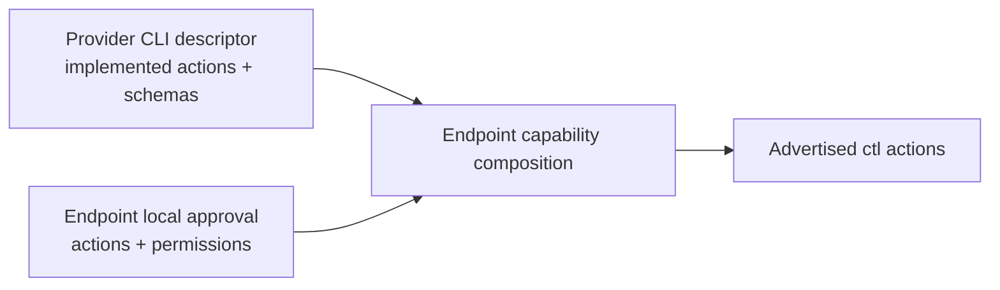
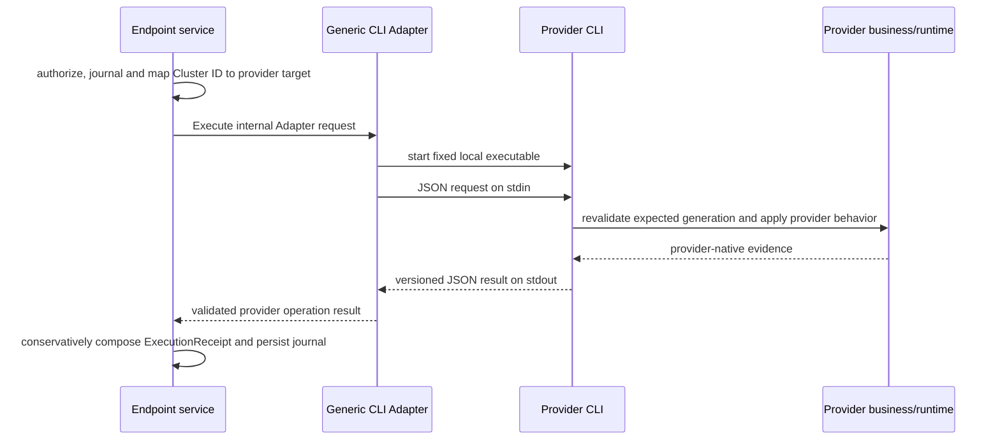

# Abstract Resources and Protocol

## Resource model

| Resource | Meaning | Key fields |
|---|---|---|
| Endpoint | One machine with one registered OS management daemon and multiple adapters | endpoint_id, display_name, labels, instance_id, connection_state, observed_at_ms |
| LaunchProfile | Endpoint-published standard execution preset | launch_profile_id, display_name, profile_revision, permitted standard inputs |
| Agent | Provider runtime identity or logical worker | provider_agent_id, provider_generation, state, state_reason |
| Session | A conversation/execution context | cluster_session_id, provider_session_id, provider_agent_id, provider_generation, state, observed_at_ms, provider_pid |
| Task | Optional unit of provider work | task_id, cluster_session_id nullable, parent_task_id nullable, state, progress nullable |
| Command | One admitted user intent | command_id, target, operation, payload_schema_version, deadline_at_ms, state |
| Observation | One typed state change or snapshot fact | endpoint_epoch, sequence, resource_id, resource_revision, observed_at_ms |
| OutputSource | Optional stdout/stderr/provider event source | source_id, target, kind, mode, cursor_support, retention_hint |

Agent, Session and Task are distinct: one agent may have several sessions; a session may have several tasks; a provider may have no task concept. Report an absent capability rather than inventing tasks. TopsailAI may need a synthetic logical worker identity per runtime binding/session; its exact mapping must be validated against real inventory before freezing the schema.

Use stable opaque cluster resource IDs scoped by Endpoint, privately mapped by Endpoint to adapter/provider IDs. Public IDs must not encode adapter routing semantics. Never use list row numbers, display names or bare PIDs as routing identities. Persist provider mapping; do not mint new IDs on each discovery. A PID can be a private locator hint but cannot be the sole generation proof. Provider ID reuse creates a new generation.

One provider session identifier may produce several independently selectable Session resources when the provider reports several execution/output rows for it. Each row receives its own opaque `session_id` in the cluster while retaining the shared `provider_session_id` as descriptive evidence. `provider_session_qualifier` is an optional descriptive label for distinguishing those sibling rows in an operator surface; it never participates in routing, authorization or capability selection. A provider session identifier that matches several rows is ambiguous input, so clients must require an opaque cluster ID or a previously rendered row number instead of selecting the first row.

Separate endpoint connection state (`online`, `suspect`, `offline`) from observed agent state (`running`, `idle`, `waiting_input`, `stopped`, `unknown`) and task state (`pending`, `running`, `succeeded`, `failed`, `cancelled`, `unknown`). Map only states supported by actual evidence; publish only a standard bounded reason code/message, keeping provider-specific diagnostics local. Store observation time and Server receive time separately. Creation/update timestamps are UTC epoch milliseconds; durations/deadlines are not inferred from timestamps alone.

## Implemented unverified session reporting and admission

A provider can list a session record while proving no live process behind it. For TopsailAI this
happens when no process holds the session output file, so `process_generation` is `null`
(`cli/cli_topsailai/core.py:1284-1287`). An empty generation therefore means **liveness unverified**,
not "the record does not exist".

The Endpoint reports such a session instead of dropping it. Dropping it made the session disappear
from the only surface that can address it, so an operator read a shorter list as "the task is gone"
while the record and its output were intact. The reported session carries `state=unknown` and
`state_reason=liveness_unverified`, with an empty generation.

Admission then follows one rule: an empty generation cannot prove which process an operation would
reach, so every operation that addresses a live process fails closed with `generation_required`.
`agent.resume` is the sole exception, because it addresses the provider session by handle and exists
precisely for the case where the process is gone.

The guard runs before generation revalidation, and that order is load-bearing. Revalidation compares
the requested generation with the observed one (`internal/endpoint/executor.go:301`), and two empty
strings compare equal, so without the guard an unverified session would pass the comparison and reach
the provider as if it were live. A regression test asserts that `message.send` and `agent.stop` are
rejected and `agent.resume` executes, and it fails when the guard is removed.

`InspectResult` separates `Found` from `Live` for the same reason. `Found` means the provider still
lists the record; `Live` means it also proved a process holds it. Resume authorizes on the absence of
a live target, so it reads `Live`. Reading `Found` would refuse to resume exactly the sessions resume
exists for.

The TUI keeps the row visible and labels it `unverified`. Entering it is refused with the real reason
and the resume hint, never with "session not found" and never with "generation changed", because
neither is true and both hide the only recovery step.

The fleet summary reports the reported state only. An unverified session is reported as `unknown`, so
it is counted in the unknown bucket like any other unknown state, and the summary line names no
subset. The line therefore reports one dimension, the reported state, and its numbers add up to the
row count. An earlier version appended `unverified(n)` after the state tally; that was removed on
2026-11-09 because a second label on the same line made the numbers ambiguous about which dimension
each one counted. The per-row distinction is carried by the table row, the `info` detail and the
refusal message instead, so dropping the label hides nothing. The flag is derived from `state_reason`
at render time rather than stored in the report, so one fact has one source of truth and no protocol
or schema change is needed.

The session-state colour mapping is deliberately small, because a colour is read before any label
is. Green means running, dim means a state that needs no attention, red means a state that needs
attention, and yellow is the remaining uncertain middle:

| Colour | States | Meaning |
|---|---|---|
| green | `running` | actively working |
| dim | `stopped`, `completed`, `idle`, `unknown`, `unverified`, `no sessions` | nothing running, nothing failed |
| red | `failed`, `error`, `offline` | a definite negative |
| yellow | `waiting_input`, `ready` | uncertain, needs a look |

`idle`, `unknown` and `unverified` share dim on purpose. They are all states where nothing is
actively running and nothing has failed, so an operator scanning the table should not have to read
them. The difference between an unverified session and a provider-reported unknown session is carried
by the `info` detail and by the refusal message, not by the row colour and not by the summary line. A
colour therefore identifies a family of conditions rather than exactly one condition, and the detail
carries the finer distinction.

`offline` is red rather than yellow because it is a definite negative, not an uncertain middle. The
endpoint connection state `offline` is a separate domain with its own mapping, and both are red, so
the two never disagree about what an offline condition looks like.

`unverified` is a colour key only and never a state: the SESSION_STATUS cell still renders the
reported `unknown`, because the state vocabulary is a protocol contract.

`no sessions` is a placeholder row, not a session state. It stands for an Endpoint that reported an
empty inventory, so the row carries no session identity and cannot be addressed. It is dim rather than
yellow because yellow means "uncertain, needs a look", while an empty inventory is a definite answer:
colouring it yellow made a healthy Endpoint with nothing to show read as a condition the operator had
to investigate. It stays outside the state vocabulary, so the SESSION_STATUS cell and the summary line
print the placeholder text and never a state name.

## How a standard operation is defined

A standard operation is defined by the cluster, from the cluster's own model of what an operator
needs. It is never derived from what a provider happens to expose. The order is fixed:

1. Name the abstract resource and its opaque identity.
2. Name the operation, its target kind, its payload and its result document.
3. Assign its safety class and its required permission.
4. Define its standard error codes.
5. Only then write the adapter mapping that reaches a provider.

Steps 1 to 4 are the contract. Step 5 is adapter-private and may change without touching the
contract. A design that cannot complete steps 1 to 4 without naming a provider has not reached the
contract yet, and must not be implemented as if it had.

Two consequences follow, and both are load-bearing:

- A provider's numbering, index, row number, file layout or flag spelling is presentation, never an
  identity and never a wire field. The cluster mints its own opaque ID through
  `adapter.ResourceMapper`, and an operator-typed number is resolved client-side against the last
  rendered list, exactly as `resume <row>` already works.
- A capability the cluster needs as a first-class operation is a standard operation with its own
  name, safety class and permission. It must not be reachable only through the generic
  `ctl.<action>` family, because that family exists for provider-specific actions that the cluster
  deliberately does not model.

A new read surface reuses the existing read pattern rather than inventing one: an optional adapter
interface, a protocol query/result pair, a channel frame pair, a Server route that forwards the
caller token, an Endpoint policy rule and a client method. The history read is the reference
instance of that pattern, and the Endpoint access policy is the reference for the policy rule.

## Capability contract

Endpoint publishes standard versioned capabilities for itself, abstract resources and LaunchProfiles. Private adapter capabilities never appear on the wire. Minimum admission requirements are health and bounded discovery of at least one supported resource kind. The MVP platform must implement agent start/resume/stop. Endpoint reports precise standard resource/profile support; an unsupported lifecycle operation is an explicit integration gap, not a silent substitute. Task and output modes remain capability-dependent.

Each advertised operation includes a stable semantic name/version, target kinds, request and result JSON Schemas, payload limits, safety class, required permissions, execution/acknowledgement meaning, deduplication scope and platform prerequisites. The revision string is carried on every admitted command and is part of the deduplication hash, but no admission path compares it against the Endpoint's current revision: an operation is served when its name and version are still advertised, whatever revision the command carries. A changed descriptor therefore does not trigger revalidation.

### A capability claim describes reachability, not the strongest available guarantee

A capability claim answers one question: can this Endpoint perform the operation at all? It must not
answer a different question: can this Endpoint perform the operation in the best available way?

The distinction is load-bearing because the two answers can disagree, and when they do, the stricter
answer removes a capability that works. An operation may be reachable through a weaker mechanism while
a stronger mechanism is unavailable, and the weaker mechanism is still a correct implementation of the
contract. Advertising the operation is then accurate; withholding it is a false negative that the
operator experiences as a missing feature rather than as a safety decision.

The rule is stated as three requirements:

| Requirement | Meaning |
|---|---|
| Advertise what can be performed | If the operation can be carried out correctly, it is advertised, whatever mechanism carries it out. |
| Record the mechanism, do not gate on it | A weaker binding is reported as evidence of the guarantee actually provided, so a consumer can tell the two apart. It is never a precondition for advertising. |
| Gate only on what makes the operation impossible | A precondition belongs in the gate only when its absence means the operation cannot be performed correctly at all. |

Consequences that MUST hold for every capability:

- A gate must be evaluated by the component that performs the work, or must be proven to agree with
  that component. A gate that probes a different layer than the one that executes can pass while the
  operation fails, or fail while the operation would succeed. Both directions are defects.
- The guarantee actually provided is carried in the result, not inferred from the capability. A
  receipt that says which mechanism was used lets an operator judge the evidence without the
  capability set having to encode every strength.
- A stricter gate is not automatically safer. It is safer only when the weaker path is incorrect; when
  the weaker path is correct, the stricter gate is a capability loss with no safety gain.
- A capability gap is reported as a gap. A missing capability must never be the way an implementation
  limitation is expressed when the operation is in fact reachable.

Why this is a contract rule rather than an implementation preference: the capability set is what the
Server, the operator CLI and any future consumer read to decide what to offer. A false negative
therefore propagates outward as an absent command, an absent action or a disabled control, and nothing
downstream can recover the capability that was withheld. The failure is also silent in the direction
that matters: no error is logged, because nothing was attempted. The only symptom is a feature that
does not exist, which reads as "not implemented" rather than "implemented but hidden".

This was learned by getting it wrong. The `agent.stop` gate probed whether the kernel could open a
pidfd, while the signal was delivered by a provider CLI whose interpreter had no pidfd bindings. The
gate passed on that host, so the capability was advertised and the operation failed at execution. The
same gate would have failed on a host where the kernel probe was unavailable but the CLI could still
signal after re-verifying the process identity, which would have hidden a working operation. The gate
now requires only a readable process table, and the binding actually used is reported in the receipt.
See `providers/topsailai/issues/stop-gate-probes-kernel-not-interpreter.md`.

### Standard safety classes

`safety_class` is a closed vocabulary defined by the cluster, not a free-form provider label:

| Value | Meaning |
|---|---|
| `read_only` | The operation never changes provider state. |
| `mutating` | The operation may change provider state. |

The distinction is part of the contract because it decides what an operator is asked to confirm and
what a credential must hold. A read-only listing advertised as `mutating` is a contract lie: it
forces a confirmation prompt and a stronger permission onto an operation that changes nothing, and it
hides the real mutating operation behind the same label. An operation whose class is not one of the
two values is rejected rather than guessed.

Suggested semantic operations:

- `message.send`: submit literal user input; does not imply consumption.
- `context.inject`: queue side-context; distinct from normal user input.
- `execution.interrupt`: only advertise when the exact interrupt semantics are defined; there is no universal safe interrupt mapping.
- `session.read_messages`: read permitted conversation context.
- `runtime.health`: control-channel health, not model progress.
- `agent.start`, `agent.resume`, `agent.stop`: required MVP lifecycle operations, with standard agent/session linkage and execution-generation evidence.
- `workspace.clean`: delete provider-owned expired artifacts for one exact Session. It is a mutating `control` operation with an empty standard payload. The target is the opaque cluster Session ID; provider selectors remain private to the Endpoint. A missing live generation is allowed only after authoritative inspection confirms the exact mapped record still exists. The operation never falls back to a session-only selector and never applies to a different matching row.
- `agent.drive.start`, `agent.drive.stop`: controller operations, distinct from the agent lifecycle; see the drive semantics section.
- `output.snapshot`, `output.follow`: independent capabilities; the former never implies the latter.
- `ctl.<action>`: one advertised provider control action per capability, with a fixed payload schema; see the provider control channel section.
- `command.exec`: one allowlisted argv array executed in a session working directory; see the allowlisted command execution section.
- `project.add`, `project.remove`: change one Endpoint's project registry entry. Both are mutating `control` operations and neither touches project data on disk. `project.add` is the only standard mutation without a target, because the resource does not exist yet; its folder is confined to the configured project root. `project.remove` targets the opaque `project_id` and carries no generation. See the project registration operations section.

Only operations and input/result fields defined by the negotiated standard API are exposed. No provider namespaces, adapter routing selectors or arbitrary provider execution schemas are accepted in commands. Two standard operation families are defined for provider control and for allowlisted command execution: `ctl.<action>` and `command.exec`. Both are versioned standard operations with fixed payload schemas, not a passthrough for provider-specific instructions. Inventory may carry adapter IDs and standard descriptive summaries as report data. A new common semantic operation requires an explicit versioned protocol amendment; provider-only controls that are not advertised as `ctl.<action>` remain local to Endpoint. Server validates standard schemas, not dynamically supplied provider instructions.

## Provider control channel

The `ctl.<action>` family exposes provider-specific control actions without making provider-native
commands part of the Cluster protocol. Each advertised action remains a separate versioned capability
with a fixed payload schema. The Server treats the action name as an opaque standard identifier and
never selects provider code or interprets provider semantics.

Under the target provider CLI architecture, the effective action inventory is the intersection of two
independent inputs:



- The provider CLI descriptor states which actions it implements and supplies their payload schemas.
  Provider-native argv, SDK calls and files remain inside the provider project.
- Endpoint-local policy approves the subset that may be exposed and assigns each action a permission
  from the closed Cluster vocabulary.
- An action must appear in both inputs. Absence from either side rejects it before dispatch.
- The Endpoint validates the payload against the effective advertised schema before invoking the
  provider CLI. An invalid payload is never passed through as an opaque provider instruction.
- Actions that read conversation content require an explicit sensitive-data permission.
- A descriptor or policy change republishes the effective capability set. The advertised revision
  string does not change unless the operator edits the Adapter configuration, so a changed descriptor
  is not detectable from the revision alone.

The target Endpoint configuration contains no provider argv template and no placeholder substitution.
A remote request supplies only the advertised `ctl.<action>` name and its validated standard payload.
The provider CLI decides how that action reaches provider business logic.

### Removed control catalog

The Endpoint-local control-action catalog held `command` and `payload_session_field`, and the Endpoint
substituted `{session}` and `{payload}` into provider argv templates. `2b58a0a2` deleted it, so this is
history rather than a compatibility contract or a supported legacy path.

The Provider CLI replacement moved provider-native argv construction into `providers/topsailai` and
changed Endpoint-local policy to approve action names and permissions only. The command templates and
placeholder substitution were removed once the new descriptor and policy intersection became
executable. There is no dual-path action parity phase and no fallback to the old catalog. Existing
fail-closed behavior, standard action names, payload validation and permissions are acceptance
requirements derived from the Cluster contract and tests.

## Allowlisted command execution

`command.exec` runs one configured local command at the Endpoint in a resolved working directory. It is
a bounded, allowlisted operation, not a remote shell.

- The request carries an argv array, never a command string. The Endpoint does not parse or split a
  string, because doing so would reintroduce shell semantics.
- The Endpoint matches the argv array against an Endpoint-global allowlist by prefix. An entry is a
  token sequence, so `git status` matches `git status --short` and does not match `git -c ...`.
- The allowlist is Endpoint-local administrative configuration. The Server validates the standard
  payload shape and never interprets the allowlist.
- The working directory has exactly two sources, and which one applies is decided by the target the
  intent carries. A session target uses the session `project_workspace`, falling back to the session
  `pwd`. A target-less intent addresses the machine, so it uses the Endpoint-local
  `AGENT_CLUSTER_ENDPOINT_COMMAND_DIR` (`--command-dir`). When the applicable source does not resolve
  to an existing directory the operation fails closed; it never falls back to the Endpoint process
  working directory.
- A target-less intent is the endpoint-scope form. It carries no resource identity, so the Endpoint
  resolves it against the one configured adapter that publishes the capability: zero adapters refuse
  with `adapter_not_configured`, and several refuse with `target_ambiguous` because the choice would
  otherwise depend on configuration order. The capability set is published per adapter, so the
  operation is validated against that adapter's descriptor even though the command itself runs on the
  Endpoint.
- An unconfigured `AGENT_CLUSTER_ENDPOINT_COMMAND_DIR` is a refusal, not a default. The error names the
  setting, because a silent fallback to the process directory would make the confinement boundary
  depend on how the Endpoint was started.
- Arguments are confined to the resolved directory. Absolute argument paths and parent traversal are
  rejected, and confinement is checked on the resolved path rather than on the argument text alone.
- Execution uses a minimal environment, a bounded lifetime, a bounded output read with truncation
  evidence, and process-group termination on timeout.
- The result is one bounded snapshot with its observation time. It is not a stream, not a follow, and
  not a durable subscription.
- The allowlist supports reload without restarting the Endpoint. A reload parses the new list
  completely before swapping it atomically; a parse failure keeps the previous list and is logged, and
  a reload never leaves an empty list in force.

## Endpoint access policy

The Server is a router, not an authorizer. It verifies that the caller may talk to
the cluster, that the addressed Endpoint exists, and that a live channel reaches
it. It then forwards the request unchanged. It never decides whether an operation
is permitted, and it never inspects an Endpoint policy.

Authorization belongs to the Endpoint, because the Endpoint is the only party that
knows what it can serve and the only party that performs the work. A caller that
the Server accepts still reaches an Endpoint that may refuse it, and a compromised
Server cannot widen what an Endpoint serves.

A CLI therefore presents two independent credentials. The `server-token` is
verified by the Server and answers whether the caller may talk to the cluster at
all; it stays in the HTTP `Authorization` header and terminates at the Server. The
`endpoint-token` is verified by the Endpoint and answers whether the caller may
exercise an operation on that machine; it travels inside the request body and then
inside the channel frame, because it must survive past the Server. The Server
forwards it without interpreting it, exactly as it forwards an opaque provider
response. A request that omits the `endpoint-token` is refused by the Endpoint and
never falls back to a default policy, because a missing credential must not be
weaker than a wrong one.

The two hops have different reachability requirements. The CLI reaches the Server over
HTTP, so the CLI's network must be able to reach the Server; that is the only hop an
operator has to arrange. The Server and the Endpoint speak WebSocket, and either side
may dial, so the link is established as soon as one side can reach the other. A machine
that can neither dial out nor be dialled is unreachable, which is a network fact rather
than a policy decision.

The policy is an Endpoint-local directory, not one file, because different callers need
different authority on the same machine. Each file describes exactly one token and is
selected by the token that caller presents. The token is the only dimension that can
select a policy, because a caller Endpoint ID is asserted rather than proven and a
policy keyed on it would let any caller claim the most permissive identity.

A token file declares three things: the `endpoints` that accept the token, the `scopes`
it is granted, and the `permissions` it is granted. `scopes` and `permissions` are
additive, so a declaration can only widen what the token may do and never silently
narrow it; a file that declares neither grants nothing, which is why an empty file is
rejected at load. `endpoints` is the only narrowing declaration: it limits where the
token is accepted, and it is verifiable because the Endpoint knows its own identity
instead of trusting a claim. One file set therefore serves the whole fleet, and a token
that names several Endpoints is accepted by each of them.

The directory has three states: permissive when it is not configured, restrictive when
it contains token files, and denying per token when a file contains `deny-all`. A token
that presents a credential with no matching file is refused, because falling back to a
permissive default would mean that adding one token file silently leaves every other
caller unrestricted. The directory reuses the five operator scope names, so an operator
learns one vocabulary rather than two. It reloads on `SIGHUP` and keeps the previous
policy when a reload fails.

A refused read returns the same `policy_denied` code the command operations already
return, with the refused operation named in the message, so one refusal has one code
instead of a vocabulary that grows with every read operation added. The scope
vocabulary is closed, so `endpoint_admin` stays in it even though no Endpoint
operation requires it: removing a name would make an existing policy file fail to
load. A `permissions` entry may name an operation the Endpoint does not serve, and the
load emits a warning instead of failing, so one file set serves a version-skewed
fleet; the warning is mandatory because that acceptance is the only place a mistake
can be silent.

Tokens are provisioned by the operator, not issued by the Server, because a Server that
held the token table would become a second authorizer. A maintenance script creates,
lists, edits, removes and rotates token files, and it never signals the Endpoint itself:
the operator reloads explicitly, so a script run cannot silently change the behaviour of
a running Endpoint. The script is a convenience over files an operator can edit by hand,
not a privileged path.

The CLI obtains each Endpoint's token from its own configuration, never from the Server. A
Server-side distribution path would make the Server a token holder, and a holder can hand tokens
out, which is the authority this design removes. The CLI therefore keeps a local map from Endpoint
identity to token in the same per-user configuration file it already reads for the Server URL and
the `server-token`, so one precedence rule and one parser cover every setting. A CLI that addresses
an Endpoint with no entry in its map refuses locally and reports a configuration error rather than
sending a request without a credential, because an Endpoint refusal would describe the symptom and
hide the cause.

Nine frame-level reads are served by their own frame type instead of an immutable
intent, so they never reach the policy hook and the Endpoint checks each one at its
frame handler: `output.read`, `output.follow`, `agent.model.list`, `project.list`, `launch.query`,
`history.read`, `messages.read`, `metrics.read` and `detail.read`. All nine are
checked today. `agent.model.list`, `project.list`, `metrics.read` and `detail.read` have operation
constants; the other five are policy identifiers rather than protocol operations,
because those frames carry no operation constant. None of the eight appears as an
operation field on the wire. Inventory publication, heartbeat, command receipt
delivery, the fleet list and the session list stay outside the policy, so a denying
caller still sees which machines and sessions exist while being unable to read their
content or operate them.

Because the Server no longer authorizes operations, five Server-side checks are
removed: command admission, output read, messages read, history read and model
catalog read. The Server keeps three checks, and all three concern reachability
rather than permission: caller authentication (`401 unauthorized`), Endpoint
existence (`404 endpoint_not_found`) and channel liveness (`503 endpoint_offline`).
Endpoint existence and channel liveness must be reported separately, because a
router that cannot distinguish "no such address" from "address unreachable" has not
verified the address.

The full contract, directory layout, file format and enforcement points are in
`docs/agent-cluster-endpoint-access-policy.md`.

## Implemented signed Endpoint credential

The Endpoint credential has two forms, and the Endpoint decides which one it accepts from its own
configuration rather than from the caller's syntax.

| Mode | What the caller presents | What the Endpoint verifies |
|---|---|---|
| `bearer` | The token itself, in `X-Endpoint-Auth` or the compatibility header `X-Endpoint-Token` | The token matches a declared `token` or `token-sha256` |
| `hmac` | `key_id`, timestamp, nonce and signature in `X-Endpoint-Auth` | The signature over the canonical request, using the secret declared for that key identifier |

The signed form proves possession without transmitting the secret, so the Server never needs the
Endpoint secret and never becomes a second Endpoint authorizer. The Server parses the credential
into a typed value, attaches it to the channel frame envelope as `endpoint_credential`, and
forwards it verbatim. It never validates it and never decides what it permits.

The signed string covers the operation, the Endpoint identity, the request digest, the timestamp
and the nonce. It deliberately excludes `request_id`, because the Server mints that identifier and
a CLI cannot predict it. Replay protection therefore rests on the request digest, the Endpoint's
nonce cache and the existing `command_id` deduplication together, not on the timestamp alone.

A signature that fails to verify is an authentication failure, never a policy decision, and the
Endpoint never falls back to bearer when a signed credential is refused. A credential whose form
does not match the configured mode is refused the same way. The two refusals carry different
codes so an operator knows which remedy applies: `credential_rejected` with HTTP `401` when the
caller could not be authenticated, and `policy_denied` with HTTP `403` when an authenticated caller
was refused an operation. The credential is checked before the policy is consulted, so a caller
that cannot prove possession never learns which operations exist.

The policy file gains one additive directive, `key-id <id>`, which names the secret used to verify
a signature. A file that declares only `token` or only `token-sha256` keeps loading unchanged and
keeps accepting bearer callers, so an existing policy directory needs no edit. `key-id` cannot be
combined with `token-sha256`, because a digest cannot verify a signature.

## Required agent lifecycle semantics

- `agent.start` targets Endpoint and opaque launch_profile_id/profile_revision. Endpoint validates the standard intent and invokes its configured Adapter CLI start operation; the CLI/runtime controls how the independent Agent starts. No arbitrary shell or remote executable configuration is accepted.
- `agent.resume` invokes the Adapter CLI resume operation for an exact durable resource reference. Do not emulate unsupported resume by creating a fresh conversation or by implementing an Endpoint process supervisor.
- `agent.stop` invokes the Adapter CLI stop operation for the selected target. Distinguish it from turn interruption. Endpoint does not directly kill or adopt Agent processes; any graceful/force policy and termination evidence come from the reviewed CLI contract. Report unsupported or unknown when that evidence is unavailable.
- Endpoint restart affects controller connections/collection, not Agent lifetime. It can rediscover returned resources through Adapter CLI and recover command delivery records; it never reparents, reattaches supervision or automatically restarts Agents. This holds only when the Endpoint and the Agents have separate lifecycle boundaries: when they share one, such as a container that hosts both, recreating that boundary kills the Agents even though the Endpoint issued no command. See `docs/agent-cluster-architecture.md` for the observed case and the deployment consequence.
- A crash after a CLI invocation can leave effects unknown. Query through Adapter CLI if a correlated query exists; otherwise report uncertainty without replaying side effects. The journal tracks controller intent/delivery, not ownership of Agent processes.
- Freeze public resource/profile revision and command identity. Endpoint-local mapping selects the CLI; Server retains only standard API semantics.

## Drive controller semantics

A drive controller is a resident process that acts on the operator's behalf by
submitting input to one session when that session is waiting for input. It is a
controller, not a parent: it does not own, supervise or restart the agent, and
stopping it leaves the agent running. The concept is provider-neutral; the
protocol never names a provider script, environment variable or record path.

- `agent.drive.start` targets one session and asks the Endpoint to start a
  controller for it. The Endpoint validates the standard intent and invokes its
  configured Adapter CLI; the provider runtime decides how the controller runs.
  Starting a controller authorizes autonomous, repeated input submission, so it
  requires a control-class permission and an explicit operator confirmation.
- `agent.drive.stop` stops only the controller for the selected target. It is
  never `agent.stop`: the agent keeps running, and the confirmation text must
  state that difference. It addresses the recorded controller, including a
  residual record whose process is already gone, so it does not require a live
  target.
- Controller state is a read, not a command. It is reported as a bounded
  descriptive `drive` summary on the standard Session resource and served from
  the persisted inventory like any other projection, so a status read never
  enters the command journal and never claims to be a live probe.
- Standard drive states are `none`, `running`, `stale`, `exited`, `failed` and
  `unknown`. A record whose liveness was not verified is `stale` or `unknown`,
  never `running`: an operator who believes a controller is active when it is
  not would stop supervising the session. An absent summary means the provider
  reported no observation, which is not a confirmed absence of a controller.
- A provider that cannot confirm the outcome reports `unconfirmed` with unknown
  effect certainty. It is never retried automatically and never reported as a
  definite failure.
- The Endpoint never supervises, adopts, restarts or kills the controller, and
  never reads provider record files. A controller that survives an Endpoint
  restart is expected, not a leak.

## Standard Adapter CLI protocol

The Adapter is a provider-neutral service boundary owned by the Endpoint. Its generic CLI
implementation calls a locally configured provider CLI through a versioned process protocol. The
provider CLI may be written in any language, is independently built, and belongs to a project under
`providers/` rather than to the Endpoint binary.

### The two contracts

The Endpoint-internal Adapter contract and the external process protocol are deliberately distinct:

| Contract | Participants | Representation | Authority carried |
|---|---|---|---|
| Endpoint-internal Adapter contract | Endpoint and generic CLI Adapter | In-process typed DTOs | Endpoint may retain Cluster command context internally. |
| Adapter CLI protocol | Generic CLI Adapter and provider CLI | Versioned JSON/JSONL | Provider target, standard function, typed payload, deadline and budgets only. |

The generic CLI Adapter translates between them. It must not serialize a complete Cluster
`ImmutableIntent`, public `Session` or `ExecutionReceipt` onto the provider process boundary.

### Standard Adapter functions

| Function | Contract |
|---|---|
| `describe` | Return bootstrap protocol compatibility, provider descriptor revision, implemented standard operations, standard queries, control actions, concurrency limits and health prerequisites without changing provider state. |
| `discover` | Return bounded provider observations and explicit completeness, revision and freshness evidence. |
| `inspect` | Revalidate one provider-private resource key and generation within a budget. |
| `resolve` | Mint the mapping key for a provider session identifier the Endpoint has not discovered yet. It is local bookkeeping: the Provider hashes the identifier and never invokes the business CLI, so it cannot become an existence check. The response carries only the minted key and the resource kind, never existence, liveness or generation. |
| `execute` | Perform one standard mutating operation against a provider-private target after revalidating its expected generation in the execution path. |
| `query` | Perform one read-only query whose name and request/result schemas are defined by the Cluster standard registry. |
| `query_command` | Optionally reconcile a prior provider invocation by its stable invocation ID or provider correlation reference; unsupported is not failure. |
| `read_output` | Return one bounded output snapshot with observation, truncation and gap evidence. |
| `follow_output` | Stream bounded output records and exactly one terminal frame while the process channel remains writable. |
| `watch` | Optionally stream provider observation changes; absence of support is explicit. |

The Endpoint, not the provider CLI, owns durable Cluster command IDs, authorization, policy, audit,
deduplication, resource mapping, the effective capability set, public receipts and network protocol. The
revision string attached to that set is the Provider's own `descriptor_revision`, copied through
unchanged, so the Endpoint owns the set and not the label.

### Invocation sequence



The provider CLI may invoke another CLI, call an API or SDK, or use another local business mechanism;
that call is outside the Adapter CLI contract.

### Invocation and framing

The generic CLI Adapter starts the configured executable directly with no shell. This is direct local
process invocation, not the public Cluster operation `command.exec`. A non-streaming invocation reads
one UTF-8 JSON request from stdin and writes one UTF-8 JSON response to stdout. A streaming invocation
reads one JSON request and writes JSON Lines, one complete frame per line. Stderr is bounded diagnostic
text and is never parsed as a successful result.

A request contains at least the fields below. The three budget values are the ones the shipped
Endpoint sends: `genericCLIMaxStdoutBytes = 1 << 20`, `genericCLIMaxStderrBytes = 64 << 10` and
`genericCLIMaxRecords = 128` (`src/main/agent-cluster-endpoint/adapter_factory.go:35-37`). They are
sent as the Endpoint's own values rather than narrowed by the provider, so a provider cannot widen
them. A follow stream that exceeds `max_records` is terminated with
`provider stream record limit exceeded`, which is a deliberate fail-closed bound and not a provider
fault.

```json
{
  "protocol": "agent-cluster-adapter",
  "major": 1,
  "minor": 0,
  "request_id": "req_opaque",
  "function": "execute",
  "adapter_id": "topsailai-work",
  "invocation_id": "inv_opaque",
  "deadline_at_ms": 1794470400000,
  "budget": {
    "max_stdout_bytes": 1048576,
    "max_stderr_bytes": 65536,
    "max_records": 128
  },
  "target": {
    "provider_resource_key": "provider-private-key",
    "expected_generation": "generation-7"
  },
  "operation": {
    "name": "message.send",
    "version": "v1"
  },
  "payload": {
    "text": "hello"
  }
}
```

The per-request document never contains Endpoint credentials, caller authority, Cluster resource IDs,
request hashes, command revisions, journal phase, executable path, provider argv, provider config path,
test mode or environment overrides. Provider startup configuration and secrets are fixed local
administrative configuration and are not copied into every request.

A successful provider operation response contains provider evidence, not a complete Cluster receipt:

```json
{
  "protocol": "agent-cluster-adapter",
  "major": 1,
  "minor": 0,
  "request_id": "req_opaque",
  "ok": true,
  "result": {
    "provider_request_ref": "provider-ref",
    "delivery_boundary": "submitted",
    "effect_certainty": "acknowledged",
    "provider_outcome": "accepted",
    "provider_response": "",
    "provider_response_truncated": false,
    "started_at_ms": 1794470399900,
    "finished_at_ms": 1794470400000
  }
}
```

An error response carries a standard error object. Its effect certainty is provider evidence and may
be downgraded by the Endpoint when process or framing failure makes the effect less certain.

```json
{
  "protocol": "agent-cluster-adapter",
  "major": 1,
  "minor": 0,
  "request_id": "req_opaque",
  "ok": false,
  "error": {
    "code": "unsupported",
    "message": "operation is not supported",
    "retryable": false,
    "effect_certainty": "not_applied"
  }
}
```

Streaming frames use `started`, operation-specific record types and `end`. Every frame repeats the
request ID. A normal stream has exactly one `end`; EOF without `end` is `stream_interrupted`, never a
clean completion. Cancellation may prevent the provider from writing its terminal frame, so the
Endpoint owns the authoritative interrupted result.

### Missing, null and empty values

Presence and nullability are separate checks, so an absent field, a field present as JSON `null` and a
field present with an empty value do not share one outcome.

An absent required field fails the presence check, which reads the raw object and rejects only a missing
key. A request without `payload` fails with `provider request field payload is required`, and a record
frame without `record` fails with `record frame field record is required`.

A container that is present as `null` passes the presence check and is then rejected by the value check.
A `null` `payload` fails with `payload must not be null`, and a `null` `record` on a record frame fails
with `record frame must not contain null`. The optional `query_result` and observation `attributes` are
checked only when present, and then fail with `query_result must not be null` and
`observation attributes must not be null`. An empty object or empty array is accepted, because only
`null` is forbidden; `payload` may therefore be `{}` but never `null`.

An identifier is rejected in all three states, but not with one message. An absent `adapter_id` fails the
presence check with `provider request field adapter_id is required`, while a `null` or empty `adapter_id`
passes that check and fails the identifier check with `adapter_id is required`. Containers and
identifiers therefore differ in what they accept, not in whether they are checked: a container has a
meaningful empty form and accepts it, while an identifier has none and rejects every empty form.

A field that a frame type forbids is rejected whenever it is present, including when its value is
`null`, with `<label> must not contain <name>`. A `started` frame therefore accepts an absent `record`
and rejects a `null` one with `started frame must not contain record`, because the forbidden-field check
treats a present `null` as present.

### Provider observations and Cluster identity

A discovery result returns `ProviderObservation` records with provider-private identity:

```json
{
  "provider_resource_key": "provider-private-key",
  "provider_generation": "generation-7",
  "resource_kind": "session",
  "state": "running",
  "state_reason": "",
  "observed_at_ms": 1794470400000
}
```

It does not return `cluster_session_id` or another public Cluster ID. The Endpoint alone maps the
provider identity through `ResourceMapper`, builds the standard inventory resource, and performs the
reverse lookup before later provider calls. The durable mapping identity is the tuple:

```text
(adapter_id, resource_kind, provider_resource_key)
```

`resource_kind` is a closed Cluster vocabulary. It is part of identity rather than descriptive data,
so a provider may use the same private key for a Session and a Task without collapsing them into one
Cluster resource. Adapter discovery and Endpoint collection must not both mint or remap the same
Cluster identity.

A provider must keep `provider_resource_key` stable for the same business resource across process
restarts, repeated discovery and protocol-compatible provider upgrades. A provider must not silently
change the key format. An unavoidable incompatible identity change requires one of: an explicit old-key
alias, an Endpoint mapping migration, or a new Adapter identity approved as a breaking migration. The
provider project must test key stability across every claimed compatible upgrade; executable
conformance can prove repeatability for one version but cannot prove cross-version continuity.

Custody survival is a provider-runtime property the protocol cannot carry: `operation_result` declares no survival, durability or liveness field, so a Provider reports only the handoff evidence it received and no executable conformance test can prove that a durable Agent outlives the Provider CLI process.

Four identities remain distinct:

| Identity | Owner and purpose |
|---|---|
| `adapter_id` | Endpoint-local identity of one configured provider instance and the namespace used by `ResourceMapper`. |
| `launch_profile_id` | Public opaque identity of one standard launch preset; one Adapter instance may publish several profiles. |
| Provider launch-profile key | Provider-private preset key resolved only inside the Endpoint/provider seam. |
| Cluster resource ID | Endpoint-minted public identity of one discovered Agent, Session, Task or other standard resource. |

The Endpoint resolves `launch_profile_id` to `adapter_id` plus a provider-private launch-profile key.
The current implementation where a launch profile ID doubles as an Adapter ID is a coupling to remove,
not a compatibility model to preserve in the Provider CLI contract.

### Query framing

`query` is the single framing function for provider-neutral read surfaces. Its names and schemas form
a closed, versioned Cluster registry. Eight queries are registered, all at version `v1`:

| Query | Addresses | Target required | Session set in payload |
|---|---|---|---|
| `launch.options` | a launch profile | no | no |
| `history.messages` | a session | no | no |
| `model.catalog` | a session | yes | no |
| `project.catalog` | an Endpoint project registry | no | no |
| `session.messages` | a session | yes | no |
| `session.metrics` | a session | yes | no |
| `session.metrics.batch` | a set of sessions | no | yes |
| `session.detail` | a session | yes | no |

`internal/providercli/queries.go` is the single source of truth for that list, and it also states the
two addressing rules once, because two callers need each of them for different reasons: the decoder
rejects a request that breaks the rule, and the conformance suite builds a request that satisfies it.
`QueryRequiresSessionTarget` names `session.metrics.batch` explicitly as the exception rather than
leaving it to the default, so a reader cannot mistake its absence for an omission.
`QueryRequiresSessionSet` covers the batch query, whose set travels in the payload because it
addresses many resources rather than one. A second copy of either rule in the suite would let a newly
registered query be exercised with a request that breaks its own rule, and the resulting failure would
read as a Provider defect rather than as a gap in the test.

A session-addressed query targets the Provider's own session identifier, not a Cluster resource ID,
because a session with no live process has no Cluster resource ID and these reads exist precisely for
such a session.

`project.catalog` is the standard Project seam. A Provider returns bounded project observations with a
stable Provider-private key, name and path. The Endpoint maps `(adapter_id, project,
provider_resource_key)` to an opaque Cluster `project_id`; the Server and CLI see only that standard
identity. `launch.options` returns launch profiles only and never carries projects.

### Project registration operations

`project.add` and `project.remove` are standard mutations that change one Endpoint's project registry
entry. They are configuration operations: neither creates, modifies nor deletes project data on disk,
and removal leaves the folder and its contents untouched. The confirmation text states that difference
because an operator who expects a deletion would otherwise read a successful removal as a lost project.

`project.add` is the only standard mutation that carries no target, because the resource it creates does
not exist yet. It is a named exception rather than a relaxation of the target rule: every other
`execute` still requires a target, and the Endpoint resolves the Adapter with the same "exactly one
capable Adapter" rule `command.exec` uses, refusing with `adapter_not_configured` when none publishes
the capability and `target_ambiguous` when several do.

The payload carries `folder`, an absolute path, and an optional `name` label. The resolved folder must
lie inside `AGENT_CLUSTER_ENDPOINT_PROJECT_ROOT`. An unconfigured root is a refusal, never a default, so
the capability stays unavailable until an operator enables it explicitly. Confinement is decided on the
resolved path, so `..`, an absolute escape and a symlink escape are all refused. The Endpoint checks
before dispatch and the Provider re-checks before writing its registry, which closes the window between
validation and the write.

`project.remove` targets one opaque `project_id` and carries no generation. The Endpoint's durable
mapping lookup already refuses an unknown project ID as `target_not_found`, so reaching the executor
proves the exact mapped row exists; a project is not a session, so no provider liveness inspection is
issued. The caller carries the exact folder in the opaque `provider_target` slot, because the Cluster
mapping key is a digest and cannot be reversed. The Provider recomputes the key from that folder and
refuses a mismatch, so a slot naming a different folder cannot remove an entry the caller never
addressed.

Both operations require the `control` scope. They are available in workspace and Endpoint scope and
never in Session scope.

### A read carries the exact-target evidence the caller already holds

A read that addresses one session carries the Provider's own opaque exact-target evidence when the
caller already holds it. The caller reads it from the committed inventory, so sending it costs
nothing; omitting it forces the Provider to recover the same identity by scanning every workspace row
and recomputing a digest for each one.

The evidence travels in the standard `provider_target` slot. It is bounded, opaque to the Cluster and
forwarded unchanged. The Cluster never models its contents, so a second Provider may fill the slot
with an entirely different document and nothing above the adapter changes.

| Field | Meaning | When absent |
|---|---|---|
| `provider_target` | opaque Provider-owned exact-target evidence | the Provider resolves the target from the opaque mapping key |

It is optional, and the fallback is the previous behaviour rather than a second code path, so a caller
with no inventory row keeps its reachability. The slot supplements Cluster identity: the Provider must
bind it to the durable Provider resource key or session key it accompanies, and a slot that names a
different resource is refused before any Provider process starts. Authorization, ownership, generation
comparison and Provider same-path revalidation remain in force.

This is the general rule, not a `model.catalog` detail: a value the caller holds travels down as one
explicit slot, and a read reaches its answer in one Provider call. A second Provider call whose only
purpose is to translate an identity is a defect, not a design.

Query capabilities and mutating operation capabilities are separate typed descriptor collections, so
a read cannot become a mutation through classification ambiguity.

```json
{
  "function": "query",
  "query": {
    "name": "model.catalog",
    "version": "v1"
  },
  "target": {
    "provider_resource_key": "provider-private-key",
    "expected_generation": "generation-7"
  },
  "payload": {}
}
```

A provider may advertise support for a registered query or return `unsupported`; it may not create a
provider-namespaced arbitrary query. Queries are read-only. Any state-changing behavior uses `execute`,
and approved provider-specific controls use `ctl.<action>`.

### Implemented provider document seams

Two fields carry provider documents the Cluster deliberately does not model. They are the only
document seams in the protocol, and they exist because an operator asking for a session's detail wants
the facts the Provider keeps, not a curated subset the Cluster guessed at. The capability revision is a
third Provider-decided seam of a different kind, described under "The capability revision seam" below.

| Seam | Producer | Forwarding rule |
|---|---|---|
| `provider_metadata` | the Provider's session record | forwarded verbatim, whole record |
| `provider_runtime` | the Provider's runtime observation | forwarded verbatim, raw bytes |

Both travel in the `session.detail` query result. Both are optional strings, and the contract fixes
only their position and their bound.

**The Cluster never models the document's shape.** A cluster type built from one Provider's fields
would have to change whenever that Provider changed, and a second Provider would then need a
protocol, Server, schema and CLI change to be supported at all. Forwarding the Provider's own
document keeps the abstraction intact: a second Provider may report an entirely different document
and nothing above the adapter changes.

**Both are optional.** A Provider that reports neither is honest about it, and the surface renders
the absence as `not reported` rather than inventing an observation. Requiring either field would
force a Provider to emit a placeholder, and a placeholder is a claim nobody made.

**Both are bounded, and the bound is a rejection rather than a truncation.** `DefaultMaxDetailBytes`
is 1 MiB and `MaxDetailCeilingBytes` is 2 MiB; an Endpoint may configure any bound in that range
through `AGENT_CLUSTER_ENDPOINT_DETAIL_MAX_BYTES` or `--detail-max-bytes`. An oversized document is
refused with `detail_response_too_large`. There is no truncation flag, because a shortened Provider
document presented as the whole record is worse than a refused read: the operator cannot tell which
fields are missing, and a flag would make a partial document look like a supported outcome.

The ceiling exists because the document travels inside a provider response envelope, and JSON string
escaping expands a document by up to six times when it contains control characters. The Endpoint
derives its provider stdout budget from the ceiling, so the two cannot drift apart: the budget is six
times the ceiling, which is exactly the worst-case expansion of the largest document the contract
permits. A bound above the ceiling could never be satisfied, because the transport would reject the
envelope before the document bound was consulted and the operator would read a transport failure
instead of the rejection this contract defines.

**Forwarding is byte-level, never a typed round trip.** An adapter that decodes a Provider document
into a struct and re-encodes it silently drops every field the struct does not model, and the
operator then reads a trimmed record as the whole one. The Provider CLI therefore forwards the raw
bytes it received.

**`provider_runtime` is host-scoped while `provider_metadata` is not.** A session recorded on another
host is described without a runtime envelope, because this host cannot observe a process it cannot
see. That is an unobservable row, not a Provider failure, so the seam stays empty and the surface
reports `not reported`. A Provider call that actually fails is returned as an error instead, because
an empty field would present a failed read as a row nobody measured.

The Provider side enforces no bound of its own. The bound is a Cluster contract, so a Provider that
also rejected a document would create a second, invisible limit: an operator who raised the Endpoint
bound would still be refused by the Provider, and the refusal would arrive as a generic provider
error that sends the investigation to a Provider behaving correctly.

### A seam's content belongs to the Provider, and the Cluster never edits it

This is a floor, not a preference. A seam fixes a **position** and a **bound**. It never fixes the
content, and it never authorises the Cluster to reshape what arrives.

The rule is stated as three prohibitions, because each one is a different way to break it:

| Prohibited | Meaning |
|---|---|
| The Cluster decides what a seam contains | Which fields belong in `provider_metadata` is the Provider's decision, not the Cluster's. |
| The Cluster edits a seam's bytes | Removing a key, merging two documents, or re-encoding a document is a content change, even when the result looks tidier. |
| The Cluster interprets a seam to render it differently | A renderer may format bytes for a human. It may not decide that one key is redundant with another field and hide it. |

Consequences that MUST hold for every change:

- De-duplication between two seams is the Provider's job. If `provider_metadata` and
  `provider_runtime` would carry the same object, the Provider decides which seam keeps it, and the
  Cluster forwards both answers unchanged.
- A Cluster-side "just drop this key" or "skip this key when rendering" is a defect, not a
  convenience. It makes the Cluster a second author of a Provider document, and the two authors will
  disagree the moment the Provider changes.
- The only Cluster-side work on a seam is addressing: which resource, which row, which bound. That
  work belongs in `internal/protocol` and the adapter, and it never touches the document body.
- A Provider that wants a different split changes its own project. `providers/<name>/` is an
  independent module, so a content decision never requires a Cluster, Server, schema or CLI change.

**The worked example is `session.detail`.** The Cluster forwards two seams, `provider_metadata` and
`provider_runtime`. The Provider's `runtime info` command publishes one document that contains both a
session record and a `runtime` object, so the two seams would overlap. The correct fix is inside
`providers/topsailai`: that Provider decides how the document is split between the two seams. The
incorrect fix is in `internal/`: dropping the `runtime` key from `provider_metadata`, or teaching the
TUI renderer to skip it. Both of those make the Cluster the author of a Provider document, and both
would silently diverge the first time the Provider changed its record.

The same example shows where the Cluster's legitimate work stops. A `session.detail` read must name
one row, because a session and its task children share one session identifier. Carrying that row
identity is addressing, and it belongs in `SessionDetailQuery` and the adapter. Deciding what the row's
document contains is not addressing, and it belongs to the Provider.

Why this is a floor rather than a guideline: a seam exists so that a second Provider can be added
without touching the Cluster. The moment the Cluster edits a seam, the seam describes the Cluster's
opinion of one Provider instead of that Provider's own record, and the second Provider inherits an
opinion that was never about it. The failure is also silent in the direction that matters: the edited
document still renders, still looks complete, and only the field that was dropped is missing, which
nobody can see because it is not there.

### The capability revision seam

The advertised capability revision is the third seam where the content is decided entirely by the
Provider. It differs from the two document seams above in what it carries and in why it exists.

| Seam | Producer | Forwarding rule |
|---|---|---|
| `capability_revision` | the Provider's `descriptor_revision` in the `describe` result | copied through unchanged, never derived and never substituted |

**The Provider decides the value, and the Endpoint only forwards it.** `descriptor_revision` is a
required field of the `describe` result, so a Provider cannot omit it; an empty value is refused as
`descriptor_revision is required` before any capability is published. The Endpoint copies it into the
advertised capability descriptor verbatim. It is not derived from the intersected capability set, and it
is not the `revision` string the Adapter configuration declares.

**Why it is a seam rather than a Cluster-computed value.** Only the Provider knows when its own
implementation changed. A Cluster-computed hash would change on every descriptor refresh, because the
intersected capability set is an input to it, and a revision that changes without the implementation
changing is not a revision an operator can reason about. A configured string has the opposite defect: it
is written once by an operator and never updated, which is why every Endpoint in a fleet used to publish
the same value while serving different surfaces. The Provider's own constant is the only value that
changes exactly when the implementation changes.

**The seam carries no admission authority.** No admission path compares the advertised revision. A
command is admitted by operation name and operation version, so a changed revision never refuses a
command and a stale revision never admits one. The value exists for the operator and for the capabilities
API, and `docs/agent-cluster-database.md` records the same limit for the persisted column.

**A Provider that changes its implementation must change `descriptor_revision`.** The obligation is on
the Provider because the Cluster cannot detect the change any other way. A Provider that ships a new
implementation under an unchanged revision makes the seam report a stale fact, which is the defect this
seam replaced rather than a new failure mode.

### Version and capability compatibility

`protocol` is the fixed identifier `agent-cluster-adapter`. The `describe` bootstrap envelope uses the
fixed major-version request shape above; an executable that cannot parse that bootstrap request is
incompatible. A higher minor version is accepted only when every required field and advertised feature
is understood; otherwise the invocation fails with `incompatible_protocol`.

`describe` reports the supported major/minor range, provider descriptor revision, standard operations,
standard queries, control actions, limits and concurrency constraints. The Endpoint intersects that
descriptor with the Cluster registry, Endpoint-supported behavior, the Adapter configuration's
capability allowlist and local policy. The advertised capability revision is the Provider's own
`descriptor_revision`, copied through unchanged; it is not derived from the intersected capability set,
and it is not the `revision` string the Adapter configuration declares. The Provider is the only party
that knows when its implementation changed, so it is the only party that can honestly report a
revision: a configured string is written once by an operator and never updated, which is why every
Endpoint in a fleet used to publish the same value while serving different surfaces. `descriptor_revision`
is a required field of the `describe` result, so a Provider cannot omit it: an empty value is refused as
`descriptor_revision is required` before any capability is published, and the configured string is never
substituted for it. The published value is `unknown` only when no adapter declaration reached the Server
at all, such as an inventory frame that could not be decoded; that is an absent report, not a Provider
that declined to name its revision.

The Endpoint refreshes an Adapter descriptor on Endpoint startup, Adapter add/change and provider
executable-version switch. Periodic discovery uses the accepted cached descriptor and does not invoke
`describe` every cycle. A control action approval reload is not a refresh trigger: the control action
catalog is Provider-side configuration read by the Provider CLI at its own process boundary, so an
approval changes what the next Provider CLI invocation reads rather than what the Endpoint has cached. A failed refresh never converts the provider surface to an apparently healthy
empty capability set and never leaves the old descriptor advertised as current: the Adapter instance becomes
`degraded` or `unavailable`, its last valid inventory remains explicitly stale, and new mutating
operations are refused until a compatible descriptor is accepted. Recovery re-describes the Adapter and
republishes the inventory before admitting new mutation. The advertised revision string is unchanged by
that recovery, because it is the Provider's own constant rather than a value derived from the descriptor's
capability lists.

### Identity, generation and invocation rules

Cluster resource IDs never cross into provider authority. Requests identify a provider target with an
opaque provider resource key plus the generation evidence last reported by that provider CLI. Two
empty generations never prove identity.

A separate `inspect` is a useful preflight but cannot prevent a target from changing before another
process performs `execute`. Every mutation that targets a live resource therefore carries
`expected_generation`, and the provider CLI re-reads the target and compares its actual generation in
the same call path, before applying the behavior. Unknown or future operations use this live-target
rule by default. If a provider cannot provide that property, it must report the limitation and must
not advertise safe support for that operation.

Exactly three non-live mutations use a different same-path authority check and may omit
`expected_generation`: `agent.resume` rechecks that the exact record exists and is not live, rejecting
a record that has become live; `agent.drive.stop` rechecks the exact provider record and addresses its
controller without treating Session process generation as controller generation; and
`workspace.clean` rechecks that the exact mapped row still exists and that its provider selector is
unambiguous. Supplying generation on these requests remains valid, but it does not replace the
operation-specific authority check. Every failed live or non-live authority check is reported before
the provider invokes the business mutation, so rejection proves that the mutation was not applied.

Every mutating request also carries a stable opaque `invocation_id`. Recovery of the same Cluster
command reuses the same value. A provider may use it for deduplication or reconciliation, but it does
not grant journal authority and is not a Cluster resource ID. The Endpoint never changes the value and
blindly retries merely because a response was lost.

### Failure and effect rules

Process exit, protocol validity, provider outcome and effect certainty are separate facts:

- Exit zero with malformed or missing protocol output is `invalid_provider_response`.
- Exit non-zero with a valid error response preserves the standard error; bounded stderr is diagnostic
  detail, not a replacement result.
- A timeout or cancellation after delivery may have unknown effect and must not be retried
  automatically.
- Output or record limits produce explicit truncation/limit evidence or a bounded failure; they never
  turn a partial document into a complete one.
- A provider crash, extra stdout text, request-ID mismatch, incompatible version or duplicate terminal
  frame is a visible protocol failure.
- The Endpoint may downgrade `acknowledged` to `unknown` when transport evidence is incomplete; it may
  never upgrade a provider result without stronger evidence.

The Generic CLI Adapter owns wall-clock and monotonic budgets, bounded reads, exact process-group
cleanup and error logging. It must never terminate processes by a broad name match.

Provider processes have two distinct ownership classes. An invocation helper belongs to the current
provider CLI call and must exit or be cleaned up when that call completes, times out or is cancelled.
A durable provider business resource, such as an Agent started by the call, may outlive the invocation
only after the provider has completed its own explicit lifecycle custody handoff. The provider may
return `acknowledged` only after that handoff is durable and independent of the invocation process
group. If handoff completion is uncertain, the result carries `effect_certainty=unknown`; the Generic
CLI Adapter must neither guess success nor automatically retry. Conformance verifies that helpers do
not leak, while provider live tests verify that a legitimately handed-off resource survives provider
CLI exit and is not killed by later invocation cleanup.

### Configuration and trust boundary

The provider executable, fixed base arguments, working directory, process environment and protected
provider configuration are Endpoint-local administrative settings. The environment is passed through
explicitly rather than narrowed, because a Provider's own configuration arrives that way and because
the Provider is a locally trusted component running as the Endpoint's own operating-system identity,
so a whitelist would not be a security boundary. Each request carries only a
adapter ID and its operation data. Provider-specific secrets use a protected local mechanism and are
not echoed in responses, stderr, receipts or audit records.

Provider packages and Endpoint Adapter configurations have separate lifecycles. `agent-cluster-endpoint` has no
package dependency on a concrete provider; a provider such as TopsailAI is installed through the
optional `agent-cluster-provider-topsailai` package. The package installs an immutable, versioned
executable path. Installing it does not restart the Endpoint, change the active Adapter configuration or publish new
capabilities. Activation requires an explicit local per-adapter update after bootstrap compatibility and
package verification; the Endpoint then re-runs `describe`, computes a new effective capability
revision and publishes it. Rollback restores the previous versioned executable path. The mock provider
is a test artifact and is not part of default production packaging or installation.

For the MVP, the provider CLI is a locally trusted component and is not sandboxed from the Endpoint.
The rule that it must not modify Endpoint databases, journals or credentials is an integration contract,
not an enforced defense against malicious code running under the same OS identity. Reliability checks
remain mandatory even for trusted code. Untrusted providers require a future isolation design.

### Public `command.exec` remains Endpoint-native

The public standard operation `command.exec` is not implemented by starting the provider CLI. The
Endpoint retains its allowlist, working-directory resolution and confinement, minimal environment,
timeout, output bounds and exact-process cleanup. A provider may supply standard Session directory
evidence through discovery, but it cannot replace the Endpoint's command-execution policy.

### Adapter-level concurrency

Process-per-request invocations cannot coordinate through provider process memory, so the Endpoint
enforces concurrency before starting them. Each Adapter instance owns an independent scheduler and semaphores;
a blocked or slow provider must not consume another Adapter instance's capacity. The effective limit for each
class is the strictest of the Endpoint hard limit, the Adapter-local configuration and the provider
constraint accepted from `describe`:

```text
effective_limit = min(endpoint_hard_limit, binding_limit, provider_limit)
```

The standard descriptor distinguishes at least total, discovery, mutation and follow limits, plus
whether discovery must serialize with mutation. The Endpoint acquires both the total slot and the
operation-class slot, and enforces cross-class serialization when required. A provider may narrow a
limit but cannot expand an Endpoint safety bound. Queue admission is bounded and fails visibly when
full; an unlimited process backlog is never used as flow control.

### Conformance

An executable conformance suite drives a provider CLI without an Endpoint, Server, channel or Cluster
database. It verifies version negotiation, framing, request correlation, descriptor truthfulness,
standard errors, limits, cancellation, generation handling, query closure, stream termination and
secret redaction. `providers/mock` supplies both a conforming reference and locally selected broken
modes. Fault mode is test-launch configuration, never a remote request field. Every negative assertion
must be proven by observing the matching broken mode fail.

## Proposed HTTP surfaces

This table is the original proposal and is kept for the routes that do not exist yet. The
implemented surface is authoritative in `docs/API.md`, which records the exact request parameters,
response documents and failure codes for every route that is served today. Where the two disagree,
`docs/API.md` describes the running Server and this table describes an intention.

Implemented read routes that this proposal did not enumerate: `GET /api/v1/launch-options`,
`GET /api/v1/history`, `GET /api/v1/messages`, `GET /api/v1/metrics`, `POST /api/v1/metrics/batch`,
`GET /api/v1/detail` and `GET /api/v1/model-catalog`. Each is a live provider read forwarded through
the Endpoint channel, not a stored projection, and each is authorized by the Endpoint rather than by
the Server.

JSON responses use a common envelope: code, message, data, request_id, timestamp. Errors preserve
stable machine codes; HTTP statuses are meaningful. Paginated responses carry next_cursor,
snapshot_revision and has_more; sorting is deterministic with ID as a tie-breaker.

| API | Purpose |
|---|---|
| GET /api/v1/endpoints | Filtered, paginated Endpoint summaries and freshness |
| GET /api/v1/endpoints/{endpoint_id} | Endpoint aggregate health and last synchronization |
| GET /api/v1/endpoints/{endpoint_id}/capabilities | Standard Endpoint/resource operation descriptors |
| GET /api/v1/endpoints/{endpoint_id}/launch-profiles | Standard launch preset IDs, revisions and permitted standard inputs |
| PUT /api/v1/endpoints/{endpoint_id}/session-state | Authenticated Endpoint full report; commit latest JSON before acknowledgement |
| GET /api/v1/endpoints/{endpoint_id}/session-state | Read the persisted latest document with freshness/revision |
| POST /api/v1/endpoints/{endpoint_id}/session-state/refresh | Server initiates fresh collection; correlated response passes through the same persistence path |
| GET /api/v1/agents | Filter by endpoint, labels, standard state |
| GET /api/v1/sessions | Standard sessions with freshness, without provider filters |
| GET /api/v1/tasks | Optional task projection, not inferred work completion |
| POST /api/v1/commands | Admit one target-bound, capability-validated intent |
| GET /api/v1/commands/{command_id} | Durable delivery and result evidence |
| GET /api/v1/output/snapshot | Bounded output for an exact authorized source |
| GET /api/v1/output/follow | Streamed output records for an exact authorized source, newline-delimited JSON |
| GET /api/v1/events | Authorized SSE updates with replay ID |
| POST /api/v1/output/subscriptions | Admit a bounded demand-driven output subscription |
| DELETE /api/v1/output/subscriptions/{id} | Release only that owned subscription |

Enrollment, credential rotation and revocation are administrative operations specified in a later security contract. Endpoint local API exposes health/readiness, standard resources, command status and locally authorized command admission through the same internal services. Route naming can mirror the Server API under a local scope; exact local administration endpoints remain to be specified.

A command request contains client-generated command_id, endpoint_id, target kind/ID/generation (or launch_profile_id/profile_revision for start), operation/version, capability_revision, typed payload, expiry, the caller's Endpoint credential and optional expected_resource_revision. The Server derives the caller identity from the `server-token`, never from client-provided authority claims, and it forwards the Endpoint credential without interpreting it. HTTP 202 means Server admission only, which is reachability rather than permission: the Endpoint may still refuse the operation. A repeated ID with identical canonical intent returns its prior state; changed intent returns conflict. Owner checks precede duplicate-result disclosure.

## Implemented resume by provider session handle

`CommandTarget` carries exactly one of two target identities: `resource_id`, the opaque Cluster
resource ID minted by `adapter.ResourceMapper`, or `provider_session_handle`, the provider's own
session identifier. Supplying both is `target_ambiguous`, because two identities for one target would
force the Endpoint to choose which one wins.

The handle exists because an operator can name a session the Endpoint has never discovered. Requiring
a pre-existing mapping would make the client judge whether the session exists, which is exactly the
judgement the operator's explicit target makes unnecessary. The Endpoint therefore resolves the handle
locally: it selects the sole configured adapter that implements the optional `HandleResolver`
interface and asks that adapter to mint the durable mapping. No provider call happens during
resolution, so resolution never becomes an existence check.

Resolution outcomes are explicit and fail closed:

| Condition | Code |
|---|---|
| No configured adapter implements `HandleResolver` | `target_not_found` |
| More than one adapter implements `HandleResolver` | `target_ambiguous` |
| Both `resource_id` and `provider_session_handle` are set | `target_ambiguous` |

Resolution runs before the Endpoint acquires its per-target lock, because the lock key is the resolved
resource ID. Resolving inside the lock would key the lock on an empty ID and let two commands for one
session run concurrently. After resolution the target is rewritten to the resolved `resource_id` and
the handle is cleared, so every later stage sees one identity and the existing `Inspect` gate still
runs: a resolved target that the provider reports as live is rejected with `target_still_active`.

A handle-minted mapping has no provider row key, PID or task flag, because the operator named a
session rather than a row. The adapter therefore treats it as session-scoped: `Inspect` scans every
provider row matching that session and reports `Live` when any row is live. Without that scan the
mapping would match no row, `Inspect` would report `Found=false, Live=false`, and the
`target_still_active` gate would silently disappear for exactly the targets this path creates.

Whether the session exists is answered by the provider when the operation reaches it, not by the
Endpoint during resolution. A provider that refuses an unknown session returns its own error, which
the Endpoint preserves as provider evidence rather than rewriting into a Cluster-level absence claim.

SSE uses resource changes, command updates and freshness events. MVP does not periodically refresh stdout snapshots. Explicit snapshot requests are one-shot reads.

Output follow is implemented as a real stream over the existing authenticated WebSocket, not as a timer-driven snapshot. One `output_follow_request` frame starts a stream; the Endpoint answers with repeated `output_chunk` frames and exactly one terminal `output_end` frame, all correlated by the same request ID. The Server exposes it as `GET /api/v1/output/follow`, which writes newline-delimited JSON: chunk records followed by exactly one end record. A transport that cannot stream returns `503 unsupported` rather than degrading into a snapshot, because a snapshot presented as a stream would look complete while silently missing everything written after it.

## Implemented output follow byte budget

`max_bytes` bounds one followed record, because one record is one chunk. The
Endpoint forwards the requested budget to the adapter, and the adapter truncates an
oversized record on a UTF-8 boundary and labels it `truncated` instead of ending
the stream. Ending the stream would report a provider failure for what is only a
long line, and the operator would lose every record written after it.

The budget defaults to 64 KiB and is clamped to 1 MiB, matching the Server clamp so
a caller cannot request a bound the Endpoint would silently reduce. Truncation is
always labelled, because a shortened record must never be presented as complete.

## Implemented output follow terminal frame delivery

The Endpoint's terminal `output_end` frame is **best-effort**, not guaranteed. This
is a deliberate decision, not an oversight, and it is the contract a consumer must
rely on.

The Endpoint keeps no follow journal. A terminal frame that cannot be sent is
never queued, never retried and never replayed on reconnect, because retaining it
would require a durable record type, a reconnect flush order and a retention bound
on the command deduplication journal. That is a larger change than the contract
needs, and the safety property it would add is already provided elsewhere.

The property that makes best-effort safe lives on the Server. When an Endpoint
disconnects, `failPendingFollow` releases every pending follow for that Endpoint
with the Server-inferred `endpoint_offline` code. A consumer therefore always
learns that the stream was interrupted rather than finished, even though the
Endpoint never stated how it ended. The Endpoint's own terminal code is advisory:
it is delivered when the channel is up, and its absence is never a clean end.

Consequences a consumer must respect:

- A stream that stops without a terminal frame is interrupted, never complete.
  The client already fails closed this way and reports `stream_interrupted`.
- A disconnect always terminates a follow with `endpoint_offline`, which is
  inferred by the Server rather than reported by the Endpoint. A consumer must not
  expect the Endpoint's own code, such as `cancelled` or `provider_error`, to
  survive a disconnect.
- A lost terminal frame is a contract event, not routine noise. The Endpoint logs
  `output follow terminal frame lost` with the request ID and the undelivered
  code, at WARN for an offline channel and at ERROR for any other transport
  failure. It never claims the frame was deferred, because no retry exists.

A normal stop is unaffected: it still delivers exactly one terminal frame with a
clean code, and a regression test guards that path so disconnect handling cannot
mask it.

The `POST`/`DELETE /api/v1/output/subscriptions` routes above remain unimplemented proposals. They are not required for follow, because a follow stream is bounded by its own request and ends with its terminal frame; a durable subscription would add retained state that the current design does not need.

## Implemented interactive follow recovery

An interactive follow stream can end without the operator seeing any output. Two
different failures produce that symptom, and both are recovered with one bounded
snapshot instead of leaving an empty screen.

The first is an abnormal end. A stream that breaks after printing part of the tail
showed the operator a partial answer, and the snapshot is the only way to see the
rest. The measured case ended after 63 of 300 requested records with
`consumer_overflow`, so a rule based on "nothing was received" would have missed
exactly the failure that most needs recovering.

The second is a keypress that arrives before the editor's idle tick. The editor
draws pending bytes only on that tick, so a fast or repeated keypress ends the read
with the bytes still pending and they are discarded. The records were received and
never displayed. The decision is therefore made at the **print boundary**, not the
receive boundary: only bytes handed to the terminal count as output the operator
saw.

Recovery is declined in three cases, each for a reason:

- A clean end with nothing printed means the provider had nothing to show. The
  snapshot would be empty too, so printing it would only add noise.
- `endpoint_offline` means the snapshot travels the same channel and would fail
  identically, adding a second identical error.
- A keypress that became a real command means the operator deliberately moved on.
  Restoring the tail would answer a question they stopped asking. An abnormal end
  still recovers in that situation, because the stream failed rather than being
  dismissed.

The recovery prints one dim status line naming the reason before the snapshot, so a
snapshot is never mistaken for a stream that is still running. A failed snapshot is a
diagnostic, never a command failure: the stream already ended and the operator's
command was accepted before it started.

The editor no longer prints a stop label for a stream that already reported its own
end. One ending is described by one line, so the recovery line is not preceded by a
contradictory `follow stopped`.

This applies to the interactive surface only. The standalone `FollowLogs` path has no
terminal to observe a keypress, and adding a snapshot there would change its exit
semantics, so it keeps its current behaviour.

## Command lifecycle and uncertain effects

Track lifecycle separately from provider evidence:

```text
Server admitted -> dispatched -> Endpoint admitted -> executing -> finished
                 -> expired/rejected/cancelled_before_execution
executing -> unconfirmed (deadline passed with delivery sent and exit unconfirmed)
```

Evidence fields include delivery boundary, effect certainty (`not_applied`, `acknowledged`, `unknown`), provider outcome (`succeeded`, `failed`, `not_reported`), and response details. Finished execution of a CLI call does not mean successful agent work. An acknowledged FIFO write can finish the transport command while provider outcome remains not_reported. An execution timeout may have unknown effects.

The receipt also carries the provider's own return document as `provider_response`, an opaque bounded string of at most 64 KiB, with `provider_response_truncated` set when that bound was reached. It is the provider's raw answer, not a normalized standard field: Server stores and returns it verbatim and never parses it, so adding or changing a provider requires no Server code, schema or API change. A truncated document is always labelled, because a shortened provider answer must never be presented as complete evidence. On a failed invocation the document carries the provider's own stderr, which is the only evidence of why the call failed. Session-scope surfaces print this document as a separate section after this service's own receipt, so the operator can distinguish the two parts. The section is rendered as readable text for a human: a first-level value that is itself an object or a list is indented under its key, and a document that is not one JSON value is printed unchanged. That rendering is display-only, so the stored document and the `--json` envelope keep the provider's original bytes.

`unconfirmed` is terminal and always carries `unknown` effect certainty. It is written when a command is still `executing` after its immutable deadline, because delivery already happened and the exit was never confirmed. Reporting such a command as `not_applied` would deny a signal that was actually sent, and leaving it `executing` forever would hide the terminal outcome from the operator. Reads converge these rows idempotently and never overwrite a command that already reached `finished`, `rejected` or `failed`.

### Deadline semantics and the two expiry codes

`execute_before_at_ms` is an absolute UTC epoch-millisecond deadline. Zero means the intent carries no deadline, and every reader must agree on that: the Server skips admission expiry, the age-based reconciliation sweep skips the row, and the Endpoint does not bound the provider call. A positive value is a hard bound.

An Endpoint that refuses a command because of its deadline reports one of two codes, and both are terminal with `effect_certainty = not_applied` and `outcome = expired`:

| Code | Raised at | Meaning |
|---|---|---|
| `expired_before_execution` | Before admission completes | The deadline had already passed on arrival |
| `expired_after_validation` | After admission, before the provider call | Validation consumed the remaining budget |

The distinction matters because the remedy differs, and the certainty matters because the provider was provably never called. Reporting `unknown` for either case would send an operator to investigate a command that did nothing, and `unknown` is also the value that forbids automatic retry, so a safely retryable command would be labelled unsafe.

Both codes must be recorded durably before the receipt is returned. A receipt that is only returned leaves the journal at `endpoint_admitted`, and a replay then re-derives the outcome from that phase and reports `invocation_recovery_unknown`, which claims the provider might have run when it never did. The Server maps `not_applied` to `rejected`, which is terminal; an `unknown` receipt instead leaves the command `executing`, and a zero-deadline row is skipped by the reconciliation sweep, so it would never converge.

End-to-end delivery is at-least-once with bounded deduplication, NOT exactly-once execution:

- Server persists intent before replying 202. Endpoint persists admitted intent before invoking the provider.
- IDs are bound to the authenticated caller identity (`IssuerID`), the canonical payload hash and the frozen target. Deduplicate repeated transport frames on both sides. The caller is part of the binding because the same command ID presented by a different caller is a different intent, and treating it as a duplicate would let one caller observe another caller's result. The credential itself is deliberately excluded from `CanonicalHash`, so rotating a credential cannot change the deduplication identity of an unchanged command.
- Endpoint crash after provider invocation but before result persistence is an uncertain boundary. Reconcile through QueryCommand if the provider supports a correlated ID; otherwise expose unknown and require an explicit new operator decision. Never replay side effects merely because no result was stored.
- Reconnect resends retained intent with the same ID, never a new ID. Endpoint journal state decides whether to return the retained result, reconcile, or report unknown, not blindly execute again.
- A duplicate after dedup history expiry is not safe to execute. Commands have immutable expiry and an endpoint-bound admission token/validity window; reject expired or unverifiable replays and require a new intent ID.
- In-flight cancellation is capability-specific. A Server cancellation before Endpoint acceptance prevents dispatch. After acceptance, a cancellation request cannot claim that provider effects stopped.

Default offline policy: reject new mutating commands as endpoint_unavailable. A connected-to-disconnected race is reconciled by command status, not silently retried. Optional future offline queues require explicit opt-in, short TTL, target generation binding and revalidation. Never execute a stale message against a replacement session.

Endpoint reports the instance/epoch that admitted a command. On reconnect the Server grants one active connection generation; old channels are fenced. Endpoint accepts commands only on its current authorized connection and checks the generation immediately before provider invocation. Local daemon singleton locking remains an unimplemented proposal; no code acquires a lock file, so two local executors can share one identity and journal. This fences stale management dispatch, not an already-started external provider operation. Journal recovery reconciles that boundary rather than asserting cancellation.

Use absolute UTC expiry for interchange with a specified maximum clock skew, and monotonic remaining budgets for local operations. Fail closed when clock confidence is insufficient for mutating commands. Clock skew tolerance, maximum command validity and dedup retention must be specified together before implementation.

## Inventory and event synchronization

WebSocket handshake exchanges protocol major/minor, endpoint identity, instance_id, active connection generation and the Server database identity. It carries no capability revision: the `Frame` envelope has no such field, so the Server learns the revision only from the first committed inventory report. Reject incompatible major versions and negotiate optional minor features. Session synchronization uses full latest snapshots, not a persistent per-session event history.

Implemented behaviour: the Endpoint stamps `source_generation` with the fixed marker `endpoint-local` (`internal/endpoint/composer.go`), and the column is TEXT. Server-side allocation of a monotonically increasing connection generation remains an unimplemented proposal; no code assigns or validates one. Freshness therefore rests only on `observed_at_ms` plus `snapshot_revision`, and the forced-collection comparison described below never depends on generation semantics. The Endpoint serializes composition and publication, not collection: `compose` increments `snapshot_revision` under the collector lock (`internal/endpoint/composer.go:10-14,45-46`), while `Collect` takes no cycle-wide lock (`internal/endpoint/collector.go:84-108`), so a periodic cycle and a forced refresh can run provider discovery concurrently and only their results are applied under that lock. Retries reuse the original revision and immutable document. Frames carry source_generation, snapshot_revision, observed_at_ms, schema_version, report_complete=true, collection_status (ok/degraded/failed) and the inventory document. Reject lower revisions and mismatched identities. An equal revision with identical content is an idempotent acknowledgement; different content is a conflict. Timestamps are for freshness, not ordering. A newly assembled report preserves per-source observation times and marks any retained data stale. Cached sections never become fresh merely because the report revision changed.

Proposed periodic report interval is 10 seconds with jitter, independently configurable from heartbeat. Server active pull sends `inventory.refresh` with request_id, standard inventory scope (MVP: the complete Endpoint inventory), deadline and fresh=true on the authorized connection. Implemented behaviour: the Endpoint dispatches refresh frames outside its single channel read loop, so concurrent refresh requests for one Endpoint each run their own collection instead of being coalesced; request coalescing remains an unimplemented proposal. The read loop performs only in-memory bookkeeping (heartbeat, inventory and receipt acknowledgements, follow cancellation), so a long collection or command can never delay the heartbeat acknowledgement that keeps the connection alive. An older scan still cannot publish after a newer scan, because the composer increments snapshot_revision under its lock and storage rejects a report that is not newer. A pull result includes its request_id and accepted generation/revision. A refresh API response confirms only that a newly attempted collection report committed, and separately reports collection_status and per-source freshness/errors; it must not label degraded cached sections freshly collected. A strict all-fresh caller receives an explicit partial-collection result if any source failed; timeout/disconnection/database failure returns an explicit error with last-known revision available separately. A late valid result may still update the row, but does not retroactively turn a timed-out request into success. Bound per-endpoint refresh frequency and scheduler concurrency to avoid discovery amplification.

Endpoint independently invokes each configured Adapter CLI and assembles a complete report of successes, failures and unknown sources; one failed source does not block successful sources. Server may display/filter the reported adapter summaries, but does not independently discover adapters, interpret provider health semantics or decide collection completeness from private adapter logic. Both periodic push and active pull validate completeness, schema, configured byte/count/depth limits and authenticated Endpoint identity and standard resource ownership before an atomic conditional replacement of `endpoint_session_state.sessions_json`. Validate/reassemble any bounded transport chunks in memory under one snapshot ID; no partial database publication. Malformed/truncated/oversized report documents fail visibly and preserve the previous database field. Individual source collection failures instead produce a valid degraded report with stale last-known sections; report completeness is not all-source freshness. This captures a completed provider scan, not a transactional provider-wide instant.

Implemented capability reload publication is event-driven, and the only event that triggers it is a successful Adapter replace. `internal/endpoint/replace.go` calls `RefreshDescriptors` for the replaced binding after the swap commits, which re-describes only that binding, atomically replaces its cached descriptor, composes a new inventory revision from the existing source snapshots, and immediately publishes it. This path does not run provider discovery and preserves every Session and source freshness timestamp, so a capability change is never presented as a fresh Session observation. Normal periodic collection and forced refresh use the cached descriptor rather than calling `Describe` on every cycle. A control-action `SIGHUP` reload is not a trigger: the control action catalog is Provider-side configuration read by the Provider CLI at its own process boundary, so there is no Endpoint-side catalog to reload.

Every inventory publication remains pending at the Endpoint until the Server returns `inventory_ack` with a represented `snapshot_revision`. The Server sends that frame only after durable storage contains the submitted revision or a newer accepted revision. A missing acknowledgement causes the Endpoint to retry the same immutable latest report after a bounded delay and after reconnect; a newer report supersedes an older pending report, and an older acknowledgement cannot clear it. The retry state is in memory: after an Endpoint process restart, the first normal collection creates and publishes a new report instead of replaying the pre-restart revision.

Server persistence is the read authority for displayed inventory. GET Session/Agent/Task projections decode/filter this single latest document; they do not imply separate resource tables. On commit emit only endpoint_id and current revision in an inventory-changed notification. TUI reloads the current document, so missed/coalesced notifications need no old Session events. On disconnect/reconnect it reloads latest state; command notification recovery stays independent. Do not save previous JSON payloads in SSE replay or audit logs.

Implemented reachability uses an Endpoint heartbeat every 5 seconds and a 30-second Server timeout. Every authenticated frame refreshes the authoritative peer observation; a liveness sweep closes a silent peer no later than five seconds after that timeout and persists it offline. Implemented behaviour: the Server answers a heartbeat inside its read loop and dispatches every other frame to a bounded per-peer business queue drained by one worker goroutine, so a database write or an acknowledgement send delays only that peer's next business frame and never the heartbeat acknowledgement that keeps the link alive. The queue holds 16 frames and a full queue closes the connection instead of blocking the read loop or dropping the frame, because a peer that cannot absorb its own inbound frames is already unhealthy and reconnecting is the honest outcome. One worker per peer preserves arrival order, which matters because a receipt and the inventory that follows it are causally related. A worker stops when its peer is removed and refuses to write business state once a newer connection owns the Endpoint, so a superseded connection cannot overwrite current state with stale data. Removing the authoritative peer is also the request boundary: while the Endpoint is offline, the Server rejects commands, queries, output requests, follows and refreshes instead of sending or queueing them. A later authenticated connection restores delivery through its new fenced generation. There is no persisted `suspect` state. Collection errors update health separately and preserve the latest valid inventory. A successful empty inventory removes old entries by whole-field replacement, without per-session deletion tracking. Endpoint disconnection never synthesizes task failure. Reconnect requests a new complete report rather than inventory-history replay.

Implemented retention: after an Endpoint has remained offline beyond `AGENT_CLUSTER_SERVER_ENDPOINT_EXPIRY` (default `24h`), the Server deletes that Endpoint's latest inventory projection. The cleanup uses the Server-owned `offline_since_at_ms`, repeats the offline and cutoff predicates in the deleting transaction, and preserves all command records. Endpoint metadata is deleted only when no command references it; a command-referenced identity remains without its expired inventory. At Server startup, a previously persisted online row becomes offline from the recovery time, so Server downtime cannot immediately consume its retention window. This cleanup does not retire the Endpoint or revoke its credential.

SQLite serializes write transactions; use bounded transaction lengths, a bounded busy retry policy and explicit database-error responses. Configure WAL/checkpoint and durability settings deliberately with the SQLite library; publish commit evidence rather than promising hard real-time I/O. The initial single active Server owns the database. Measure JSON serialization/whole-document replacement costs, collection duration, commit latency, database/WAL size and bounded query parsing under representative retained provider history. No per-Session SQL index or database-specific JSON features are needed for MVP.

## Implemented Endpoint output authorization

Both output routes are authorized by the target Endpoint. The CLI sends the
Endpoint token through the Server, and the Endpoint checks `output.read` or
`output.follow` against its local access-policy directory before consulting the
adapter or transport. A refusal uses the machine code `policy_denied` and names the
requested operation.

The Server authenticates the CLI's Server token and verifies Endpoint existence and
channel liveness, but it does not inspect operator scopes or authorize output. This
keeps one authority in force: an Endpoint policy decision cannot be widened or
narrowed by Server configuration.

An Endpoint with no configured policy directory preserves the default all-allowed
behaviour. Once a policy directory contains a `.conf` file, only tokens represented
by its rules are accepted. The scope vocabulary remains available inside those
Endpoint policy files; it is not a Server bearer-token property.

## Output and backpressure

Real follow support requires an opaque cursor bound to source identity/generation plus an offset/sequence, rotation detection and bounded retention. Cursor expiry returns an explicit gap and recovery option. Do not derive a reliable cursor from a tail snapshot or deduplicate identical text lines: repeated lines can be legitimate.

Snapshot-only providers return snapshot_id, observation time, returned content and partial/truncation evidence. The TUI replaces the panel snapshot rather than appending inferred new lines. MVP performs no periodic stdout snapshot refresh. One-shot reads show their observation time; they promise neither complete history nor sub-second follow.

Implemented follow semantics: a follow stream is a live tail, not a historical replay. It starts from the provider's current position and carries each record's observation time, so a consumer can tell when a record was observed. It does not promise complete history, and it does not promise that no record was missed between the last snapshot and the start of the stream. A provider that cannot tail reports `unsupported` rather than returning a snapshot. The Endpoint bounds concurrent follows (`maxConcurrentFollows = 8`) and rejects an excess request with `too_many_follows` instead of queueing it, so a long follow can never starve commands, heartbeats, inventory reports or launch queries on the same channel.

Bound frame bytes, queues, output rate, subscriptions per operator and per Endpoint, CLI concurrency and snapshot size. Reserve transport capacity for heartbeat/control. Backpressure on output drops or pauses only with explicit gap/status events; control admission fails visibly when full. Slow consumers expire their subscriptions and can re-query state. Secrets and escape sequences are never rendered as trusted terminal commands.

## Descriptive adapter report metadata

Standard inventory includes adapters summaries and Session adapter_id associations as defined in `docs/agent-cluster-database.md`. Server persists/returns this data inside sessions_json and may perform generic display/filtering/structural validation, but never interprets a provider_type to select code, execute controls or route a command. Adapter management and execution remain Endpoint-local. This corrects the earlier over-strict prohibition on all adapter identifiers in reports.

## Latest-only notifications without a message system

No Session event history, durable message broker or notification outbox is required. Inventory-change notifications are lightweight invalidations emitted after commit, not authoritative data. TUI reloads latest state on initial connection/reconnection. A bounded Server-instance notification sequence detects gaps/overflow and requests full latest-state reload; a periodic lightweight revision manifest on the state channel reconciles a missed final notification while connected, including a commit-to-notify failure. The manifest contains only current endpoint IDs/revisions, not old Session payloads or stdout. Subscribe-before-read plus revision comparison closes initial-load races. Server restart changes the stream instance and forces resync. Command status is recoverable through its durable query API independently of inventory notifications.

## Implemented adapter project launch query

`GET /api/v1/launch-options?endpoint_id=ID` returns the live start-capable launch-profile catalog. `GET /api/v1/project-catalog?endpoint_id=ID` independently returns the managed projects. Both authenticated read-only APIs forward through the existing Endpoint channel, bind the response to the exact connection generation and request ID, and use bounded pending-request sets. Launch data contains `handlers`; project data contains opaque Cluster `project_id` values plus names and paths. A failed project query is not an empty successful list.

Interactive `start [endpoint]` composes the two standard seams: it auto-selects a sole launch profile, then reads `project.catalog` and asks for a project number or literal folder and a literal initial task. Empty input or cancel aborts before submission. Answers do not enter command history. The existing explicit profile syntax is retained. `profile_revision` carries the Provider-declared launch-profile revision and is revalidated before execution; it is not the capability revision. Inventory adapter summaries are not execution authority.

The TopsailAI handler invokes `project list --json`, never scans project folders or edits project registration/settings. Project responses are rejected above 1000 records or 256 KiB after provider capture; the existing provider runner captures stdout before this check, so this is not a subprocess-memory bound. Tasks are carried in the immutable start payload as `task`, validated as nonblank UTF-8 without NUL and at most 8192 bytes, and forwarded as one literal argv value. The interactive wizard accepts one input line; JSON payload callers may provide multiline tasks. Background submission is not readiness or task completion. Provider-side argv handling and real model availability remain separate integration prerequisites.

## Implemented forced collection refresh

`POST /api/v1/endpoints/{endpoint_id}/session-state/refresh` forces one fresh Endpoint collection and waits for it to be committed. The response `data` is the document re-read from storage, so it always equals a following `GET /api/v1/endpoints/{endpoint_id}/session-state`. This is the only path that makes the operator's next view fresh; `GET` and the TUI `list` command remain read-only projections of the persisted document.

The Server forwards `inventory.refresh` over the existing authenticated Endpoint channel and correlates the reply by request ID and Endpoint identity, following the same pattern as output and launch queries. At most 64 forced collections may be pending per Server. The reply is delivered only after the persistence hook has attempted the commit, so a waiter observes the post-commit state. An Endpoint disconnect fails every pending request for that Endpoint immediately instead of waiting for the deadline.

Budgets are layered so the inner component reports its own failure first: the Endpoint collection budget is 30 seconds, the Server request budget is 30 seconds, and the TUI command budget is 35 seconds.

Response outcomes:

| Status | Code | Meaning |
|---|---|---|
| 200 | `success` | The committed document is at least as new as the report this request forced |
| 503 | `unavailable` | The Server has no forced-collection channel configured |
| 503 | `endpoint_unavailable` | Transport failure, disconnect, or the request deadline expired |
| 503 | `not_committed` | The committed document could not be read back |
| 409 | `not_committed` | Storage silently ignored the report, so freshness is not proven |

The 409 case exists because storage ignores a report that is not newer than the stored document and reports success. A submitted report alone therefore cannot prove freshness, so the handler compares the committed observation time and snapshot revision against the submitted report and fails closed. A refresh response confirms only that a newly attempted collection was committed; it does not claim that every adapter source was freshly observed, and degraded sections keep their own freshness metadata.

TUI scope behaviour: workspace scope forces a collection for every Endpoint and reports per-Endpoint failures as diagnostics while still rendering the healthy Endpoints; endpoint and session scope force only the current Endpoint and fail hard, because the operator asked for that exact Endpoint. Session scope then revalidates the selected session against the committed document and renders the current endpoint table, so the operator sees the reloaded rows rather than only a confirmation line. A client without the forced-collection seam degrades to read-only behaviour, and `list` never forces a collection.

Workspace-scope collection is concurrent, because a serial loop makes the command cost the sum of every Endpoint instead of the slowest one. The client fans out one request per Endpoint through a bounded worker pool of 16, which stays below the Server's 64 pending-collection admission limit and bounds the provider discovery load one operator command can create. Each Endpoint is requested exactly once, because the Endpoint does not serialize its collection cycles: a second request would start a second full provider discovery concurrently rather than reuse the first, so it would amplify load instead of shortening the wait. Each Endpoint gets its own 32-second budget, above the Server's 30-second budget so the Server reports its explicit failure first and below the 35-second command budget so one hung Endpoint cannot consume the whole command. The committed document the refresh response returns is used directly, because the Server re-reads it from storage after the commit, so a following read would return the same document. Results are stored by Endpoint index, so the rendered order never depends on completion order.
